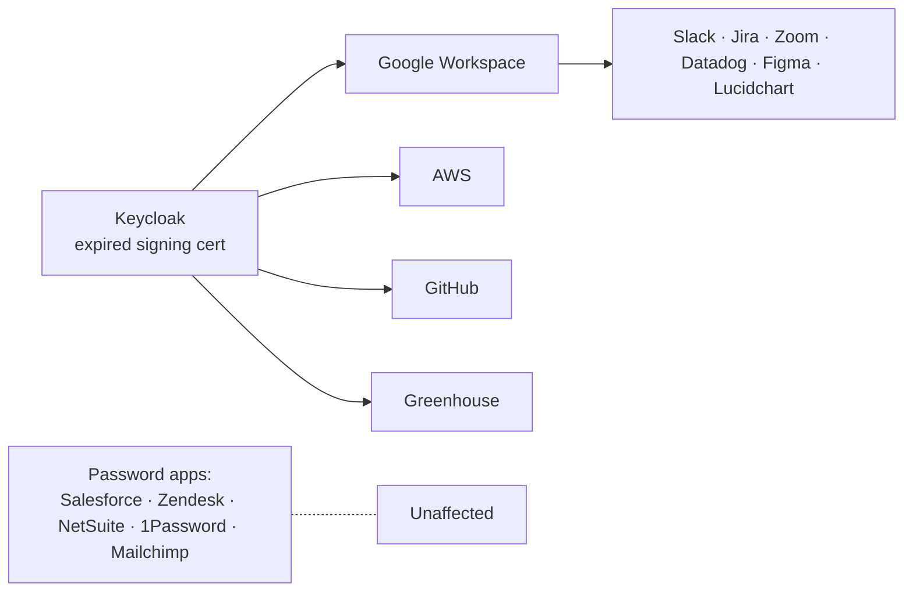

# Postmortem: IdP Outage (Expired SAML Signing Certificate)

| | |
| --- | --- |
| **Severity** | SEV-1: company-wide sign-in failure |
| **Date** | Tuesday, Nov 10, 2026 |
| **Duration** | 3h from detection to resolution (07:45–10:45 PT); 3h45m total impact (from 07:00) |
| **Incident commander** | IT Lead |
| **Status** | Resolved. Action items tracked below |
| **Format** | Blameless. Focus on systems and process, not individuals |

## Summary

AiLense's self-hosted Keycloak IdP signs SAML assertions with a certificate that **expired at 07:00 PT**. Apps that check certificate validity began rejecting sign-ins. Nothing alerted on it, and the help desk first treated the reports as individual password problems.

Once diagnosed, the team **rotated the signing key**. That fixed the expired certificate but **broke every SAML app at once**, because each app pins the IdP's certificate and needed the new one uploaded by hand. There was no list of which apps depended on Keycloak or who administered them, so restoring access took until 10:45.

## Impact

Mapped from the [app inventory](../app-inventory.md).

| App | How users sign in | Impact | Restored |
| --- | --- | --- | --- |
| Google Workspace | SAML via Keycloak | New sign-ins to email, calendar and Drive blocked | 09:10 |
| Slack, Jira/Confluence, Zoom, Datadog, Figma, Lucidchart | Sign in with Google | **Blocked indirectly:** Google sign-in itself depended on Keycloak | 09:10 (with Google) |
| AWS | SAML via Keycloak | Console access blocked for engineering, including on-call | 09:40 |
| GitHub | SAML via Keycloak | Blocked; only one org owner could update SSO settings, and they were out | 10:15 |
| Greenhouse | SAML via Keycloak | Recruiting blocked | 10:35 |
| Salesforce, Zendesk, NetSuite, 1Password, Mailchimp | Password / shared password | **Unaffected** | n/a |

- **Users affected:** about 260 of 400 hit at least one failed sign-in (estimated from help desk tickets and Keycloak logs). Users with existing sessions mostly kept working until their sessions expired.
- **Tickets:** 85 help desk tickets, 31 password resets that didn't help.
- **Customer impact:** none directly. Engineering lost new AWS console sign-ins until 09:40; on-call relied on existing CLI sessions.
- **The irony:** the password-only apps, the least secure in the inventory, were the only ones that kept working. The fix is resilient SSO, not fewer SSO apps.

## Blast Radius

Google Workspace was the **highest-leverage fix**: restoring it brought back 7 apps. That's why it was restored first.

## Timeline (PT)

```mermaid
gantt
    title Nov 10, 2026 (PT)
    dateFormat HH:mm
    axisFormat %H:%M

    section Impact
    Undetected partial outage        :crit, 07:00, 45m
    Misdiagnosed as password issues  :crit, 07:45, 25m
    Diagnosis                        :active, 08:10, 30m
    All SAML apps down after rotation:crit, 08:40, 30m
    Restoring apps one by one        :active, 09:10, 95m
```

| Time | Event |
| --- | --- |
| 07:00 | Keycloak SAML signing certificate expires. No alert. Apps that validate certificate dates start rejecting sign-ins |
| 07:45 | **Detected:** first help desk tickets ("can't sign in to Google"). Handled as individual password problems; resets don't help |
| 08:10 | Ticket volume spikes. IT Lead declares SEV-1 and takes incident commander role. Updates posted in Slack, which still works for users with existing sessions |
| 08:35 | Keycloak is up and authenticating, but apps report signature/certificate errors. **Root cause found:** expired signing certificate |
| 08:40 | IT Lead signs in to Keycloak with its local admin account (credentials in 1Password). New signing key generated, old key disabled. **Every SAML app now fails**, including those that had kept working |
| 08:50 | Team builds a list of affected apps from Keycloak's client configuration. No owners recorded. Several clients have generic names (e.g., `saml-app-03`) |
| 09:05 | `saml-app-03` identified as Greenhouse by matching its callback URL (ACS URL) to the vendor's domain. Two other clients can't be identified |
| 09:10 | Google Workspace updated by IT Lead as a Google super admin. Email and 6 "Sign in with Google" apps restored |
| 09:20 | Greenhouse admin (People Ops) is also locked out by SSO. Priority ticket opened with Greenhouse support |
| 09:40 | AWS updated by on-call SRE using a still-valid CLI session. Engineering console access restored |
| 09:45 | GitHub's only org owner reached by phone while on PTO |
| 10:15 | GitHub updated by the org owner using an SSO recovery code |
| 10:35 | Greenhouse support temporarily allows password sign-in for the admin. Certificate updated, SSO enforcement turned back on |
| 10:45 | All known apps confirmed working. **Resolved** |
| Next day | Confirmed Greenhouse SSO enforcement is back on. 2 unidentified Keycloak clients still broken with no complaints. Flagged for decommission |

## How We Regained Admin Access

**The core problem:** fixing each app meant uploading the new certificate in that app's admin settings, but **the admins also signed in through the broken SSO**. Every app needed a different way around it, and none were documented.

| App | Who fixed it | How they got in | What went wrong | Time to admin access |
| --- | --- | --- | --- | --- |
| Keycloak | IT Lead | Local admin account; credentials in 1Password | Nothing. 1Password wasn't behind SSO | ~5 min |
| Google Workspace | IT Lead | Google super admin account, which signs in with Google credentials rather than through SSO | Worked, but only one super admin was online, a single point of failure | ~10 min |
| AWS | On-call SRE | **Luck:** an existing CLI session with an admin role hadn't expired yet; updated the SAML provider from the CLI | Fallback was the root account, but its MFA hardware key was in the office safe and nobody was in the office | ~30 min |
| GitHub | Org owner (on PTO) | SSO **recovery code**, saved in the IT 1Password vault at setup | Only one org owner; took 25 min to reach them on a personal phone | ~35 min |
| Greenhouse | People Ops admin + **vendor support** | Greenhouse support verified the admin's identity and temporarily allowed password sign-in | Nobody in IT had admin. The app was hard to identify in Keycloak. Waited on the vendor support queue | ~75 min |
| 2 unidentified clients | Nobody | n/a | No owner, admin or vendor could be identified | Not restored |

**Takeaways:**

- **The password manager was the real break-glass system.** It worked only because 1Password wasn't behind SSO. That must stay true after the migration.
- **AWS recovered on luck.** If the CLI session had expired, recovery would have depended on getting into the office.
- **A temporary SSO bypass is a security gap until it's reversed.** Greenhouse's enforcement had to be confirmed back on the next day.

## Root Cause & Contributing Factors

**Root cause:** the SAML signing certificate was issued with a 2-year validity when Keycloak was set up and was never renewed.

**Contributing factors:**

1. **No owner:** Keycloak was set up by an engineer who has since left. Nobody owned it.
2. **No monitoring:** no alert on certificate expiry.
3. **No app inventory:** nobody knew which apps depended on Keycloak, who administered them, or how each one updates certificates.
4. **Rotation without a plan:** rotating the key under pressure made a partial outage total. With an inventory, the new certificate could have been staged in each app first.
5. **Single admins:** GitHub had one org owner, which delayed restoration about 35 minutes.
6. **Help desk had no runbook:** 25 minutes lost resetting passwords before escalating.
7. **Communications depended on the IdP:** updates went out in Slack, which only worked for people with existing sessions. That was luck, not design.
8. **Admin access depended on the broken SSO:** no app had a documented way for admins to get in when SSO fails (see [How We Regained Admin Access](#how-we-regained-admin-access)).

## What Went Well

- Once declared, a single incident commander coordinated the response.
- Google Workspace was restored first because it had the largest blast radius.
- Existing sessions kept most people working through the morning.
- 1Password was independent of SSO, so the Keycloak admin credentials and GitHub recovery codes were reachable.
- GitHub recovery codes had been saved at setup.

## Action Items

| # | Action | Owner | Priority | Tracked in |
| --- | --- | --- | --- | --- |
| 1 | **Interim:** inventory every certificate on the current Keycloak (signing and TLS), record expiry dates, set calendar and monitoring alerts. Migration takes months, so Keycloak must stay healthy until then | IT Lead | P0, this week | — |
| 2 | Migrate to a managed IdP (Okta) | IT | P0 | [03 IdP migration](../03-identity-sso-migration/PLAN.md) |
| 3 | Complete app inventory: owners, at least 2 admins per critical app, auth method, SAML/certificate details | IT + app owners | P0 | [App inventory](../app-inventory.md) |
| 4 | Break-glass access for the IdP and critical apps (Google Workspace, AWS, GitHub) | IT + Security | P0 | [Okta tenant setup §2](../03-identity-sso-migration/docs/okta-tenant-setup.md#2-super-admin--break-glass-accounts) |
| 5 | Certificate expiry monitoring with 60/30/7-day alerts. **Carries over to Okta:** Okta app signing certificates also expire | IT | P1 | 03 IdP migration |
| 6 | Help desk runbook: "more than 5 sign-in tickets in 15 minutes" means escalate as a possible incident | IT Support | P1 | — |
| 7 | Out-of-band communications channel that doesn't depend on the IdP (status page or SMS list from Rippling) | IT + People Ops | P1 | — |
| 8 | Document an **admin recovery path** for every critical app (how an admin gets in when SSO is down), and test it | IT + app owners | P0 | App inventory |
| 9 | AWS break-glass: a second root MFA key held off-site, or a break-glass IAM role that doesn't depend on SSO | DevOps Lead + Security | P0 | 03 IdP migration |
| 10 | Keep the password manager independent of the IdP (don't put its unlock behind Okta without an offline fallback) | Security | P1 | [Okta tenant setup §2](../03-identity-sso-migration/docs/okta-tenant-setup.md#2-super-admin--break-glass-accounts) |
| 11 | Any temporary SSO bypass used during an incident gets a ticket to confirm it's reversed | IT | P1 | Help desk runbook |
| 12 | Decommission the 2 unidentified Keycloak clients | IT | P2 | App inventory |

## SOC 2 Relevance

This postmortem and the tracked action items are evidence for the incident response criteria: **CC7.3** (evaluate security events), **CC7.4** (respond to incidents) and **CC7.5** (recover from incidents). The auditor will expect to see the action items closed or in progress.
