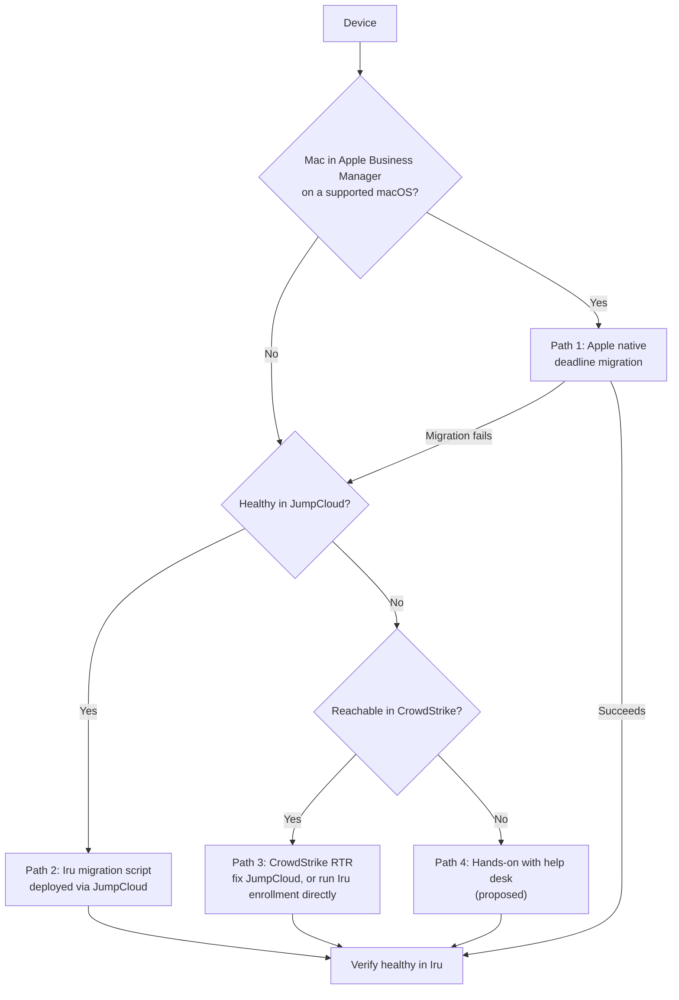

# MDM Re-enrollment Plan: JumpCloud → Iru

> Items marked **(proposed)** are recommended values to confirm with stakeholders; **[verify]** = confirm against vendor docs during the build.

## Context & Scope

| Item | Value |
| --- | --- |
| Current MDM | JumpCloud (macOS + Windows) |
| Target MDM | Iru (macOS + Windows, including Windows Autopilot zero-touch) |
| Iru readiness | Tenant tested; like-for-like policies already in place |
| **Scope** | **The migration only:** moving every device from JumpCloud to Iru with minimal disruption. Policy design is done |
| Why now | Program prerequisite: the fleet must be enrolled and healthy before the Okta Verify rollout ([program overview](../README.md)) |

## Migration Paths

Every device goes down exactly one path. The goal is to use the least disruptive path that works for each device.

### Path 1: Apple native deadline migration (Mac fleet)

- In Apple Business Manager, reassign devices from the JumpCloud MDM server to Iru and **set a migration deadline**.
- Users get OS notifications to migrate before the deadline; at the deadline the migration is enforced. **No wipe, no re-setup.**
- **Requirements [verify]:** the Mac must be in Apple Business Manager and running a macOS version that supports deadline migration (macOS 26+).
- Devices that don't meet the requirements, or fail to migrate, fall to Path 2.

### Path 2: Iru migration script via JumpCloud (Mac stragglers + Windows fleet)

- **Iru support writes** a migration script for macOS and Windows.
- Deployed through **JumpCloud's own management** (JumpCloud Commands) to the devices still in JumpCloud.
- Script flow **(proposed)**:
  1. Check prerequisites (disk space, user logged in, power/network)
  2. Remove the JumpCloud MDM enrollment (a device can only have one MDM)
  3. Enroll in Iru
  4. Report success/failure
  5. **Keep the JumpCloud agent** until the device is confirmed healthy in Iru, so there's still a management channel if enrollment fails
- **macOS caveat [verify]:** Macs enrolled without Apple Business Manager need the **user to approve** the MDM profile. The script can prompt but can't fully automate this. Plan comms and help desk support for it.
- **Windows:** while migrating, **register each device's hardware hash in Autopilot** **(proposed)** so any future rebuild or replacement is zero-touch.

### Path 3: CrowdStrike Real Time Response (unhealthy in JumpCloud)

For devices that aren't checking in to JumpCloud or have a broken agent:

- Use **CrowdStrike Falcon Real Time Response (RTR)** to run commands on the device, either to:
  - **Repair** the JumpCloud agent, then continue with Path 2, or
  - **Run the Iru enrollment directly** through RTR
- Works because CrowdStrike is an independent management channel from JumpCloud.

### Path 4: Hands-on (proposed)

Devices not reachable through JumpCloud **or** CrowdStrike: help desk works with the user on a video call, or the device is swapped/reimaged. A device missing from CrowdStrike is also a **security finding** (EDR coverage gap) and goes to workstream 05 (gap assessment).

## Pre-migration (proposed)

1. **Reconcile the device inventory** across sources to find every device and its correct path:

    | Source | What it tells us |
    | --- | --- |
    | JumpCloud | Enrolled devices, last check-in, agent health |
    | Apple Business Manager | Which Macs are eligible for Path 1 |
    | CrowdStrike | EDR coverage; Path 3 eligibility |
    | Rippling | Who should have a device; flags devices of departed employees |
    | Iru | Already-migrated devices |

    Devices in one source but not the others are hygiene findings (e.g., in CrowdStrike but not JumpCloud = unmanaged device).

2. **Disk encryption recovery keys:** keys escrowed in JumpCloud **won't transfer** to Iru **[verify]**. After migration, each device must generate and escrow a new FileVault/BitLocker key in Iru. Export the JumpCloud keys as a backup before decommissioning, and store them securely.
3. **Local user accounts:** JumpCloud manages local accounts and password sync on devices. Confirm what happens to those accounts when the JumpCloud agent is removed **[verify]**, so nobody loses their login.
4. **Comms:** announce the deadline, what users will see, and how to get help. End-user guides: [Mac (Path 1)](user-guide-mac-migration.md), [Windows (Path 2)](user-guide-windows-migration.md).

## Rollout Waves (proposed)

| Wave | Who | Purpose |
| --- | --- | --- |
| 0 | IT | Test all paths on real devices |
| 1 | Pilot volunteers across Mac + Windows | Validate comms, help desk load, script reliability |
| 2 | Department by department | Bulk migration; Path 1 deadline set per wave |
| 3 | Stragglers | Path 3/4 devices, worked one by one |

## Definition of Healthy

A device counts as migrated when **(proposed)**:

- Enrolled in Iru and checking in
- Iru policies applied (the like-for-like set)
- New disk encryption recovery key escrowed in Iru
- CrowdStrike running
- JumpCloud agent removed

**Tracked, not gating:** Okta device certificate and Okta Verify installed via Iru (see below). Needed later for device trust, but not required to start the Okta Verify rollout.

**Exit criterion:** coverage target met (e.g., 95%+ healthy) before the Okta Verify rollout starts, with every exception tracked to a named device and owner.

## Follow-on: Okta Device Management

Iru also needs to deliver Okta's device certificate and Okta Verify so Okta can recognize managed devices. **Add both to the Iru baseline before wave 2** so migrated devices don't need a second push. Task list and status are tracked in the IdP workstream: [Iru + Okta device management integration](../03-identity-sso-migration/docs/okta-tenant-setup.md#iru--okta-device-management-integration).

## Tracking

Track per device: path, wave, status (not started → in progress → migrated → healthy), and blocker. Report daily counts by path so stragglers surface early.

- **Device tracker:** [device-tracker.csv](device-tracker.csv) (mock, one row per device; opens in Excel or Google Sheets)
- **Status snapshot:** [migration-status.md](migration-status.md) (mock mid-migration rollup: by status, path, platform, department, and top blockers)

## Decisions to Confirm

- Deadline length for Path 1 (how long users get before it's enforced)
- When to decommission JumpCloud, after confirming nothing else depends on it (directory, local accounts)
