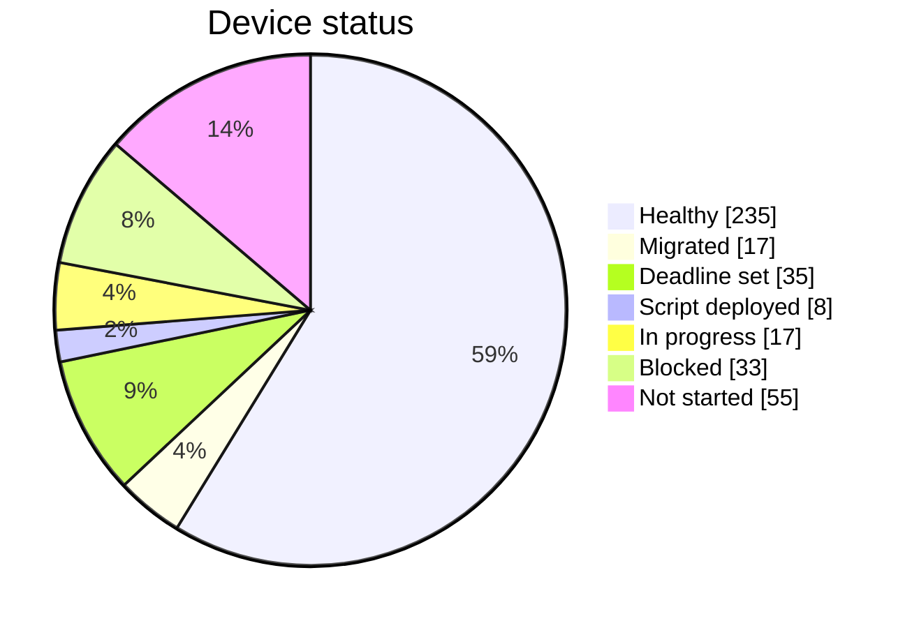

# MDM Migration Status: JumpCloud → Iru

> **MOCK DATA** · Snapshot **Dec 10, 2026** · Source: [device-tracker.csv](device-tracker.csv) · Definition of healthy: [PLAN.md](PLAN.md#definition-of-healthy)

## Headline

| Metric | Value |
| --- | --- |
| Devices in scope | 400 (306 macOS, 94 Windows) |
| **Healthy in Iru** | **235 (59%)** |
| Okta Verify gate (95%) | **Not met:** 145 more healthy devices needed |
| Departed-employee devices found (excluded) | 6 |

## By Status

| Status | Devices | Share |
| --- | --- | --- |
| Healthy | 235 | 59% |
| Migrated | 17 | 4% |
| Deadline set | 35 | 9% |
| Script deployed | 8 | 2% |
| In progress | 17 | 4% |
| Blocked | 33 | 8% |
| Not started | 55 | 14% |

## By Migration Path

| Path | Devices | Healthy | Progress |
| --- | --- | --- | --- |
| 1 - Apple deadline | 147 | 88 | 60% |
| 2 - Script via JumpCloud | 228 | 142 | 62% |
| 3 - CrowdStrike RTR | 20 | 5 | 25% |
| 4 - Hands-on | 5 | 0 | 0% |

## By Platform

| Platform | Devices | Healthy | Progress |
| --- | --- | --- | --- |
| macOS | 306 | 185 | 60% |
| Windows | 94 | 50 | 53% |

## By Department / Wave

| Department | Wave | Devices | Healthy | Progress |
| --- | --- | --- | --- | --- |
| IT | 0 | 8 | 8 | 100% |
| Pilot (mixed) | 1 | 30 | 27 | 90% |
| Engineering | 2 | 135 | 113 | 84% |
| Product & Design | 2 | 40 | 30 | 75% |
| Sales | 2 | 80 | 42 | 52% |
| Customer Success | 2 | 50 | 13 | 26% |
| Marketing | 2 | 25 | 1 | 4% |
| People & Finance | 2 | 22 | 1 | 5% |
| Exec & Legal | 2 | 10 | 0 | 0% |

## Top Blockers

| Blocker | Devices |
| --- | --- |
| Waiting on user to approve MDM profile | 21 |
| JumpCloud agent broken; RTR repair queued | 7 |
| FileVault key not escrowed in Iru: retry | 7 |
| Device offline in CrowdStrike since RTR attempt | 7 |
| JumpCloud agent removal pending health confirmation | 6 |
| Departed employee device: recover hardware | 6 |
| Not reachable via JumpCloud or CrowdStrike | 5 |
| BitLocker key not escrowed in Iru: retry | 4 |
