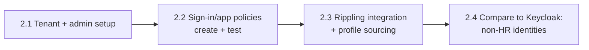
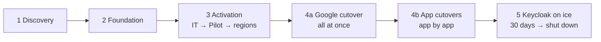
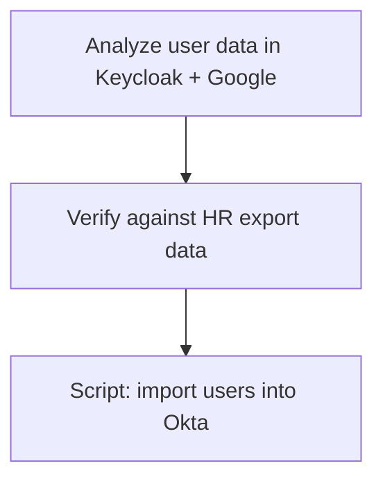

# IdP Migration Plan: Self-hosted SAML (Keycloak) → Okta

> Items marked **(proposed)** are recommended values to confirm with stakeholders; **[verify]** = confirm against vendor docs during the build.

## Context & Assumptions

| Item | Value |
| --- | --- |
| Company | AiLense; see [program overview](../README.md) |
| Trigger | 3-hour outage of the current IdP: expired SAML signing certificate (see workstream 01) |
| Company size | 400 users (per prompt) |
| Source IdP | Self-hosted Keycloak (SAML); Google Workspace and other apps federate to it |
| Target IdP | Okta |
| HR source of truth | Rippling (see [Phase 2.3](#phase-2-foundation)); alternative without an HRIS in the [appendix](#no-hr-source-of-truth) |
| Compliance driver | SOC 2, deadline in 5 months |
| SOC 2 type | Assume **Type II**; branch for Type I where it changes the plan |
| Audience | IT and Security teams |
| Format | Markdown + Mermaid diagrams, supporting scripts where useful |

**Feasibility:** 5 months is achievable for a user population of this size.

**Dependencies on other workstreams:**

- **02 MDM:** fleet must be enrolled and healthy before the Okta Verify rollout
- **05 Gap assessment:** runs in parallel; fill time waiting on app owners
- **04 HR lifecycle:** Rippling → Okta goes live at about the same time as Okta onboarding ([04-hris-lifecycle-automation](../04-hris-lifecycle-automation/PLAN.md))

## Phases

### Phase 1: Discovery & Analysis

**Goal:** Know exactly what has to move, who owns it, and how access is granted today.

- Collect inventory and log data to identify which apps need to be migrated
  - **Keycloak:** configured SAML clients and sign-in events
  - **Google:** "Sign in with Google" (OAuth) grants. These apps sit behind Keycloak indirectly, because Google federates to it
  - SSO app list is already complete from the [IdP outage](../01-incident-response/postmortem.md); **password apps are likely incomplete** and need active discovery (see [app inventory](../app-inventory.md#finding-the-missing-password-apps-proposed))
- **Work with Compliance to confirm SOC 2 scope per app.** SOC 2-required apps are prioritized into Okta setup alongside the existing SSO apps (see [prioritization](../app-inventory.md#compliance-scoping--okta-priority))
- Capture each app's current SAML configuration from Keycloak: NameID format, attributes sent, certificate. Okta must send the **same NameID**, or apps will create duplicate accounts at cutover
- Identify the owner(s) of each app
- Document how each app is assigned today: org-wide, individual, or group
  - Is the current assignment **ideal**? (right method)
  - Is it **correct**? (right people)
  - Work with app owners to confirm and sign off
  - Tracked in [app-inventory.md](../app-inventory.md)
- Inventory existing groups in Keycloak and Google, and tag each as access, org-structure, privileged, or collaboration ([group migration](docs/group-migration.md))
- Confirm Rippling is the HR source of truth and its data quality is good enough to source Okta profiles (without an HRIS, see the [appendix](#no-hr-source-of-truth))

**Groups:** redesigned around **attribute-driven group rules** (ABAC from Rippling attributes), not lifted and shifted. Hand-maintained groups are where the [assignment review](../app-inventory.md#assignment-review) found the most errors. Privileged groups stay manual with approval. Details: [group-migration.md](docs/group-migration.md).

**Timebox:** 3 weeks ([timeline](../README.md#proposed-timeline)). **Exit criteria:** inventory signed off by app owners, SOC 2 scope confirmed by Compliance, SAML details captured for every SSO app, and the first [identity reconciliation](docs/identity-reconciliation.md) run.

### Phase 2: Foundation

**Goal:** A secure, tested Okta tenant with every identity accounted for (HR-managed or not) before any user is activated or any app moves.

| Step | Summary | Detail |
| --- | --- | --- |
| **2.1 Tenant & admin setup** | Build directly in prod (net new, no impact until users are activated); backport to a sandbox org after launch; org URL `ailense.okta.com`, branding, least-privilege admin roles (no separate admin accounts; compensating controls), initial org Super Admin as break-glass | [okta-tenant-setup.md §1–2](docs/okta-tenant-setup.md#1-tenant-setup) |
| **2.2 Sign-in & app policy creation and testing** | Workshop with Security/Compliance (password, authenticators, session, app sign-in tiers, recovery, logging), then test every policy with test users in prod before any real user is activated | [okta-tenant-setup.md §3](docs/okta-tenant-setup.md#3-policy-setup-with-securitycompliance) |
| **2.3 Rippling integration & profile sourcing** | Rippling becomes the source of truth for user profiles in Okta: schema mapping, lifecycle events, users created Staged | [rippling-okta-integration.md](docs/rippling-okta-integration.md) |
| **2.4 Keycloak comparison** | Compare Rippling-sourced profiles to Keycloak to find identities HR doesn't manage (contractors, service accounts, shared accounts) and decide which to pull over | [identity-reconciliation.md](docs/identity-reconciliation.md) |

**Decision: device trust is not a day-1 requirement.**

- **Day 1:** MFA everywhere; phishing-resistant MFA for admins and sensitive apps.
- **Later:** device trust for the sensitive tier only, once MDM coverage is measured. Phasing is in [okta-tenant-setup.md §4](docs/okta-tenant-setup.md#device-trust-phasing).
- **Prep now:** the Iru + Okta integration (certificate profile, Okta Verify, Device Assurance) is configured during Phase 2 and the MDM migration, so enforcement later is just a policy change. Tracked in [okta-tenant-setup.md](docs/okta-tenant-setup.md#iru--okta-device-management-integration).
- **Why:** SOC 2 doesn't require device trust, so it stays off the critical path. Enforcing it on day 1 would tie sign-in to MDM health mid-migration, and any machine MDM missed would lock its user out.

### Phase 3: User Activation

**Goal:** every user active in Okta with MFA enrolled, before any sign-in moves off Keycloak.

**Waves:** IT → Pilot → **by major region** (AiLense is global).

| Wave | Who | Gate to start | Purpose |
| --- | --- | --- | --- |
| 0 | IT (incl. regional support staff) | Phase 2 complete | Test end to end; support staff learn it by doing it |
| 1 | Pilot volunteers, mixed regions and platforms | Wave 0 clean | Validate the guide, support load, Okta Verify enrollment |
| 2 | Region 1 (e.g., Americas) **(proposed)** | Region's [MDM health](../02-mdm-reenrollment/PLAN.md#definition-of-healthy) ≥ 95% | Bulk activation |
| 3 | Region 2 (e.g., EMEA) | Same | Bulk activation |
| 4 | Region 3 (e.g., APAC) | Same | Bulk activation |

- **Activation is scheduled for each region's local morning**, so users and local support are online when the emails land.
- Users follow the [Okta setup guide](user-guide-okta-setup.md): activate, set password, enroll MFA and Okta Verify ([rollout details](docs/okta-tenant-setup.md#4-okta-verify-rollout-via-mdm)).
- Coverage is measured with [Get-OktaManagedDeviceReport.ps1](scripts/Get-OktaManagedDeviceReport.ps1).

#### Regional support prep

Before each region's wave, the **local support team** gets a support kit:

- The end-user guide and FAQ, plus **known issues** collected from the IT and Pilot waves
- How to reset MFA safely: identity verification steps and the Help Desk admin role (no Super Admin)
- Escalation path to core IT, with on-call coverage overlapping the region's hours
- The wave schedule and the comms users received, so support knows what users were told
- Local support activates in **wave 0**, so they've been through it themselves

### Phase 4: Sign-in Cutover

#### Google Workspace: all at once

Once **every user is active** in Okta, Google's SSO setting is switched from Keycloak to Okta **for the whole org in one change**.

- **Why all at once:** a per-group cutover means different people sign in different ways at the same time, which confuses users and support. For users, the change is nearly invisible: the next time Google asks them to sign in, they get an Okta check instead of Keycloak.
- **Hard gate:** anyone not yet active in Okta would lose Google access, so the cutover waits for 100% activation (or a documented exception list with a plan for each person).
- **Rollback:** switch Google's SSO setting back to Keycloak, which is still running.
- **"Sign in with Google" apps** move with it automatically. Priority 1 apps among them still get direct SAML/SCIM in the app cutovers below ([why](../app-inventory.md#compliance-scoping--okta-priority)).

#### Apps: app by app

Apps move **one at a time, several per day**, in [inventory priority order](../app-inventory.md#compliance-scoping--okta-priority) (SOC 2 apps first).

**Per-app runbook:**

1. Build the app in Okta: SAML/OIDC for sign-in, **SCIM for provisioning wherever supported** ([why both](../app-inventory.md#sso-and-scim)); assign groups from the [assignment review](../app-inventory.md#assignment-review)
2. Match the **NameID** to what Keycloak sends today (captured in Phase 1), or accounts duplicate
3. Test with a test user
4. Cut over: point the app at Okta's metadata/certificate
5. Verify with real users; watch sign-in errors
6. **Enforce SSO-only:** turn off local password sign-in, so deactivating someone in Okta actually removes access. Keep one documented, monitored admin recovery path per app ([postmortem lesson](../01-incident-response/postmortem.md#how-we-regained-admin-access))
7. **Turn on SCIM deprovisioning** (or register the app for the offboarding Workflow's manual task if it has no SCIM)
8. **Rollback:** point the app back at Keycloak's metadata

**Comms depend on audience size:**

| App audience | Comms |
| --- | --- |
| **Org-wide** (e.g., Slack, Zoom) | Company announcement → cutover → test → announce done |
| **Smaller audience** (e.g., NetSuite, Greenhouse) | A **temporary Slack channel per app** with that app's users: what will change, when, what to expect; confirmation after; channel archived once stable |

### Phase 5: Keycloak Decommission

- **Keep it on ice:** it's hosted, so it stays running but frozen (no changes) after the last app moves. It remains the rollback target until shutdown.
- **30 days after the last cutover:** review Keycloak logs for **any unexpected sign-in activity** (a missed app, a script, an integration) and fix each one before shutdown.
- **Export Keycloak logs** covering the transition, and keep them for the audit year.
- **Cut service** once the logs are clean, and close the related [postmortem action items](../01-incident-response/postmortem.md#action-items).

**Log retention across the transition:** Okta keeps System Log data for only **90 days**, but the audit covers a full year. A SIEM, or another export-and-store solution, must hold Okta logs for **365 days** ([logging policy](docs/okta-tenant-setup.md#3-policy-setup-with-securitycompliance)). Together with the Keycloak export, that covers the whole audit period.

### Phase Summary

## Appendix: Alternative Scenario

### No HR Source of Truth

If AiLense had no HRIS, users would come from existing identity data instead of Rippling:

1. Analyze user data in Keycloak and Google
2. Verify it against HR export data
3. Write a script to import users into Okta

**Would need to be decided:**

- What the HR export is in this case (spreadsheet, payroll system, etc.)
- Import approach (CSV import vs. API script) and user activation strategy
- Does this branch end with standing up an HR source of truth, or stay manual?

The mismatch handling and non-person account rules in [identity-reconciliation.md](docs/identity-reconciliation.md) apply here too.

## Decisions to Confirm

- Who makes the rollback call for an app cutover, and on what signal? **(proposed:** IT lead with the app owner, if users still can't sign in after a set troubleshooting window**)**
- Final region boundaries and order for activation waves
