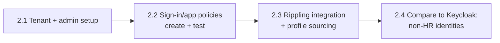
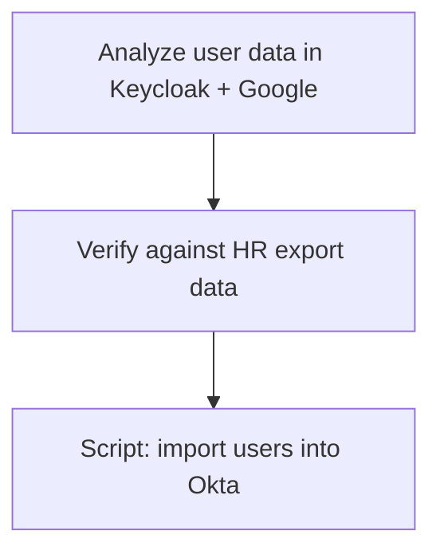

# IdP Migration Plan: Self-hosted SAML (Keycloak) → Okta

> **Status:** Working draft. Built from interview notes. Items marked _OPEN_ are unanswered.

## Context & Assumptions

| Item | Value |
| --- | --- |
| Company | AiLense (fictional startup); see [program overview](../README.md) |
| Trigger | 3-hour outage of the current IdP: expired SAML signing certificate (see workstream 01) |
| Company size | 400 users (per prompt) |
| Source IdP | Self-hosted Keycloak (SAML); Google Workspace and other apps federate to it |
| Target IdP | Okta |
| HR source of truth | Rippling (see [Phase 2.3](#phase-2-foundation)); alternative without an HRIS in the [appendix](#no-hr-source-of-truth) |
| Compliance driver | SOC 2, deadline in 5 months |
| SOC 2 type | Assume **Type II**; branch for Type I where it changes the plan |
| Audience | IT and Security teams |
| Format | Markdown + Mermaid diagrams, supporting scripts where useful |

**Feasibility:** 5 months is achievable for a user population of this size.

**Dependencies on other workstreams:**

- **02 MDM:** fleet must be enrolled and healthy before the Okta Verify rollout
- **05 Gap assessment:** runs in parallel; fill time waiting on app owners
- **04 HR lifecycle:** Rippling → Okta goes live at about the same time as Okta onboarding ([04-hris-lifecycle-automation](../04-hris-lifecycle-automation/PLAN.md))

## Phases

### Phase 1: Discovery & Analysis

**Goal:** Know exactly what has to move, who owns it, and how access is granted today.

- Collect inventory and log data to identify which apps need to be migrated
  - **Keycloak:** configured SAML clients and sign-in events
  - **Google:** "Sign in with Google" (OAuth) grants. These apps sit behind Keycloak indirectly, because Google federates to it
  - SSO app list is already complete from the [IdP outage](../01-incident-response/postmortem.md); **password apps are likely incomplete** and need active discovery (see [app inventory](../app-inventory.md#finding-the-missing-password-apps-proposed))
- **Work with Compliance to confirm SOC 2 scope per app.** SOC 2-required apps are prioritized into Okta setup alongside the existing SSO apps (see [prioritization](../app-inventory.md#compliance-scoping--okta-priority))
- Capture each app's current SAML configuration from Keycloak: NameID format, attributes sent, certificate. Okta must send the **same NameID**, or apps will create duplicate accounts at cutover
- Identify the owner(s) of each app
- Document how each app is assigned today: org-wide, individual, or group
  - Is the current assignment **ideal**? (right method)
  - Is it **correct**? (right people)
  - Work with app owners to confirm and sign off
  - Tracked in [app-inventory.md](../app-inventory.md)
- Inventory existing groups
- Confirm Rippling is the HR source of truth and its data quality is good enough to source Okta profiles (without an HRIS, see the [appendix](#no-hr-source-of-truth))

_OPEN:_

- Inventory fields per app
- Group strategy: lift-and-shift vs. redesign; attribute-driven group rules vs. manual
- Timebox and exit criteria

### Phase 2: Foundation

**Goal:** A secure, tested Okta tenant with every identity accounted for (HR-managed or not) before any user is activated or any app moves.

| Step | Summary | Detail |
| --- | --- | --- |
| **2.1 Tenant & admin setup** | Build directly in prod (net new, no impact until users are activated); backport to a sandbox org after launch; org URL `ailense.okta.com`, branding, least-privilege admin roles (no separate admin accounts; compensating controls), initial org Super Admin as break-glass | [okta-tenant-setup.md §1–2](docs/okta-tenant-setup.md#1-tenant-setup) |
| **2.2 Sign-in & app policy creation and testing** | Workshop with Security/Compliance (password, authenticators, session, app sign-in tiers, recovery, logging), then test every policy with test users in prod before any real user is activated | [okta-tenant-setup.md §3](docs/okta-tenant-setup.md#3-policy-setup-with-securitycompliance) |
| **2.3 Rippling integration & profile sourcing** | Rippling becomes the source of truth for user profiles in Okta: schema mapping, lifecycle events, users created Staged | [rippling-okta-integration.md](docs/rippling-okta-integration.md) |
| **2.4 Keycloak comparison** | Compare Rippling-sourced profiles to Keycloak to find identities HR doesn't manage (contractors, service accounts, shared accounts) and decide which to pull over | [identity-reconciliation.md](docs/identity-reconciliation.md) |

**Decision: device trust is not a day-1 requirement.**

- **Day 1:** MFA everywhere; phishing-resistant MFA for admins and sensitive apps.
- **Later:** device trust for the sensitive tier only, once MDM coverage is measured. Phasing is in [okta-tenant-setup.md §4](docs/okta-tenant-setup.md#device-trust-phasing).
- **Prep now:** the Iru + Okta integration (certificate profile, Okta Verify, Device Assurance) is configured during Phase 2 and the MDM migration, so enforcement later is just a policy change. Tracked in [okta-tenant-setup.md](docs/okta-tenant-setup.md#iru--okta-device-management-integration).
- **Why:** SOC 2 doesn't require device trust, so it stays off the critical path. Enforcing it on day 1 would tie sign-in to MDM health mid-migration, and any machine MDM missed would lock its user out.

### Phase 3+

_OPEN: phase list to come._ Okta Verify rollout (via MDM, gated by [MDM health](../02-mdm-reenrollment/PLAN.md#definition-of-healthy)) happens at user activation; details in [okta-tenant-setup.md §4](docs/okta-tenant-setup.md#4-okta-verify-rollout-via-mdm).

- **End-user guide:** [user-guide-okta-setup.md](user-guide-okta-setup.md) (activation, password, MFA, Okta Verify)
- **Coverage report:** [scripts/Get-OktaManagedDeviceReport.ps1](scripts/Get-OktaManagedDeviceReport.ps1) (users with a managed device vs. not; run with `-Demo` to try it without Okta)

## Appendix: Alternative Scenario

### No HR Source of Truth

If AiLense had no HRIS, users would come from existing identity data instead of Rippling:

1. Analyze user data in Keycloak and Google
2. Verify it against HR export data
3. Write a script to import users into Okta

_OPEN:_

- What the HR export is in this case (spreadsheet, payroll system, etc.)
- Import approach (CSV import vs. API script) and user activation strategy
- Does this branch end with standing up an HR source of truth, or stay manual?

The mismatch handling and non-person account rules in [identity-reconciliation.md](docs/identity-reconciliation.md) apply here too.

## Open Questions

- Hands-on slice: app inventory prioritization vs. SCIM/SAML mapping (or both)
- Prior IdP migration experience to draw lessons from
- Okta features in scope (Lifecycle Mgmt, Workflows, FastPass/Device Trust, OIG, etc.)
- SOC 2 controls/evidence ownership
