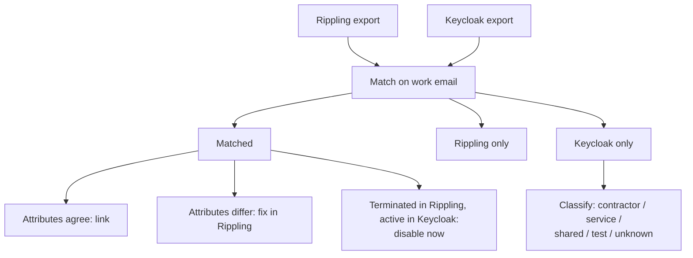

# Identity Reconciliation: Rippling vs. Keycloak

> Phase 2.4 of the [IdP migration plan](../PLAN.md#phase-2-foundation). Items marked **(proposed)** are recommended values to confirm with Security.

## Why

Rippling only knows about **people HR manages**. Keycloak has accumulated everything else: contractors, service accounts, shared logins, test accounts, and people who left but were never disabled. If we only source Okta from Rippling, those identities either **break at cutover** (a service account an integration depends on) or **silently come along** later as unmanaged accounts. We need to find them and decide on each one.

## How

1. Export users from **Rippling** (active + terminated, with employee ID, work email, status, employment type, manager)
2. Export users from **Keycloak** (username, email, enabled/disabled, last sign-in, groups)
3. Match on **work email** (Keycloak has no employee ID), then flag fuzzy matches (name changes, aliases) for manual review
4. Sort every identity into a category below
5. **Run it more than once:** first during Phase 1 for planning, again right before user activation to catch drift

## Categories & Decisions

| Category | Example | Decision **(proposed)** |
| --- | --- | --- |
| **Matched, attributes agree** | Employee in both, same name/email | Link: Okta user from Rippling, nothing to pull over |
| **Matched, attributes differ** | Name change in Rippling not reflected in Keycloak; username `jsmith` vs. email login | **Fix in Rippling** (the source). Check the NameID each app expects: if apps key on the old Keycloak username, Okta must send the same value or accounts duplicate at cutover |
| **Terminated in Rippling, active in Keycloak** | Departed employee who can still sign in | **Disable in Keycloak immediately.** Security finding for [05 gap assessment](../../README.md#workstreams); check for access in password apps too |
| **Rippling only** | New hires, people who never used SSO | No action: created by the Rippling integration. Confirm they're expected |
| **Keycloak only: contractor** | Agency contractor not in Rippling | Pull over as an **Okta-mastered user** with a sponsor (manager), `userType = Contractor`, and a **required end date**. Long-term: add contractors to Rippling |
| **Keycloak only: service account** | `svc-ci`, integration users | Don't migrate as a person. Find the owner; replace with an app-native service account or API token. If it must exist in Okta, tag it as a service account with an owner and exclude it from human MFA/lifecycle rules |
| **Keycloak only: shared account** | `support@`, team logins | **Eliminate.** Give individuals their own access via groups (same problem as Mailchimp/Zendesk in the [app inventory](../../app-inventory.md)) |
| **Keycloak only: test account** | `test-user1` | Don't migrate. Create fresh, clearly tagged test users in Okta for launch testing ([tenant setup](okta-tenant-setup.md#1-tenant-setup)) |
| **Keycloak only: unknown** | No owner identifiable | Disable in Keycloak; delete after 30 days if nobody claims it **(proposed)** |

## Output

A reconciliation report with every identity, its category, decision, owner, and status. The "pull over" list (contractors and any approved service accounts) gets created in Okta before user activation; everything else is fixed or disabled at the source.

**SOC 2 value:** the report is evidence that every identity with access is known, owned, and authorized (CC6.1, CC6.2), and the terminated-but-active findings show the gap the new lifecycle closes (CC6.3).

## Decisions to Confirm

- Who approves contractor and service account pull-overs (Security? Manager?)
- Grace period before deleting unclaimed accounts
