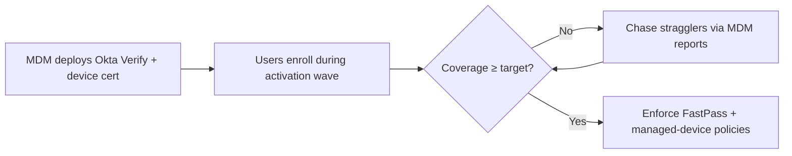

# Okta Tenant Setup, Policy & Okta Verify Rollout

> Values marked **(proposed)** are starting points for the policy workshop with Security/Compliance, not final decisions.
> Vendor-specific behavior marked **[verify]** should be confirmed against current Okta docs.

## 1. Tenant Setup

- **Orgs:** production org + a preview/sandbox org. Every policy and integration change is tested in preview first.
- **Custom domain:** e.g., `login.ailense.com`, so users learn one trusted URL (phishing awareness).
- **Branding:** company sign-in page and email templates, so Okta emails don't look like phishing.
- **Admin roles:** least privilege from day one.

| Role | Holders | Notes |
| --- | --- | --- |
| Super Admin | 2–3 named IT admins **(proposed)** | Daily-use admin accounts separate from their regular user accounts _OPEN_ |
| Break-glass Super Admin | 2 dedicated accounts | See below |
| Help Desk (custom role) | IT support | Reset MFA/password, no policy or app config |
| Read-only Admin | Security / audit | Evidence collection |
| Integration service accounts | Rippling, SIEM, scripts | Scoped roles or OAuth service apps, not personal API tokens |

## 2. Super Admin & Break-glass Accounts

**Why break-glass matters:** if SSO, MFA, or a policy change locks admins out, these are the way back in.

- **Two break-glass accounts**, not tied to any person.
- **Avoid a circular dependency:** the break-glass account's email and recovery must **not** depend on Okta. Once Google Workspace is federated to Okta, a mailbox behind Google SSO can't receive the reset email during an Okta outage. Use a mailbox that's excluded from SSO, or a separate domain.
- **Credentials:**
  - Password stored in a restricted password manager vault (e.g., 1Password break-glass vault, accessible only to Security + IT lead)
  - Sealed offline copy in a physical safe **(proposed)**
- **MFA:** two FIDO2 hardware keys per account, stored separately.
- **Exempt from** the policies most likely to lock them out (device trust, network zones), but **always** require MFA.
- **Monitoring:** any break-glass sign-in alerts Security immediately (System Log → SIEM / Slack).
- **Test quarterly:** sign in, verify, document. This produces SOC 2 evidence.
- **Google side too:** keep 2 Google Workspace super admins as break-glass. Google super admins don't sign in through third-party SSO, so they still work if Okta is down **[verify]**.
- **The tenant's first account:** the account used to create the Okta org becomes a super admin. Either make it break-glass account #1, or demote it once the named admins exist.

## 3. Policy Setup (with Security/Compliance)

**Process:** run a policy workshop with Security/Compliance in Phase 2. Record each decision with its rationale and the SOC 2 control it supports. The recorded decisions become audit evidence.

| Policy area | Proposed baseline | Rationale |
| --- | --- | --- |
| Password | Min 14 chars, block common/breached passwords, **no forced periodic rotation**, lockout after 10 failed attempts **(proposed)** | NIST 800-63B: length over complexity; rotation drives weak passwords |
| Authenticators allowed | Okta Verify (push with number challenge + FastPass), FIDO2/WebAuthn | Phishing-resistant options available |
| Authenticators disabled | SMS, voice, security questions; email as MFA factor | SIM swap and social engineering risk |
| Global session | MFA at every new sign-in; max session 12h, idle timeout 2h **(proposed)** | Balance security with daily friction |
| App sign-in tiers | **Standard:** any MFA. **Sensitive** (AWS, GitHub, NetSuite, etc.): phishing-resistant + managed device. **Okta Admin Console:** phishing-resistant, every time | Risk-tiered; maps to the app inventory |
| Network | Block anonymizers/Tor (dynamic zone); ThreatInsight enabled (log first, then block) | Credential-stuffing protection |
| Account recovery | Self-service via Okta Verify; help desk resets require **identity verification** (video call + manager confirm) **(proposed)** | Help desk social engineering is a top IdP attack path |
| Logging | Stream System Log to SIEM; retain ≥ 1 year **(proposed)** | Okta keeps logs about 90 days **[verify]**; a Type II audit window needs evidence for the full period |

### Policy testing (proposed)

Every policy is built and tested in the **preview org** first, then promoted to prod and re-tested with the same cases. Test users cover each persona: standard employee, contractor, admin, break-glass.

| Test | Expected result |
| --- | --- |
| Standard user signs in to a standard app | Okta Verify push (number challenge) accepted |
| Standard user signs in to a sensitive app with push only | Blocked; prompted for phishing-resistant factor |
| Admin opens the Okta Admin Console | Phishing-resistant factor required, every time |
| User tries to enroll SMS/voice/security question | Option not offered |
| Password below minimum length or on common-password list | Rejected |
| Session idle past timeout | Re-authentication required |
| Sign-in from an anonymizer/Tor | Blocked |
| Break-glass account signs in | Succeeds; Security alert fires |
| Help desk resets a user's MFA | Only possible via the custom help desk role; logged in System Log |
| Contractor past end date | Cannot sign in |

Results recorded with screenshots: they double as SOC 2 evidence that controls were tested before go-live.

**SOC 2 mapping:** these policies primarily support CC6.1 (logical access security), CC6.2 (user registration/authorization), CC6.3 (access modification/removal), and CC7.2 (monitoring).

## 4. Okta Verify Rollout (via MDM)

**Prerequisite:** workstream 02 (MDM re-enrollment) is complete, so every macOS and Windows machine is enrolled and healthy.

**Why Okta Verify first:** it unlocks the later capabilities.

- **FastPass:** passwordless, phishing-resistant sign-in
- **Device Assurance:** OS version, disk encryption, screen lock checks
- **Managed device conditions** in sign-in policies (the "Sensitive" tier above)
- **Future:** desktop MFA and password sync at the OS sign-in **[verify]**

### Rollout steps

1. **Package and deploy** Okta Verify silently through MDM (macOS and Windows), preconfigured with the org URL where supported **[verify]**.
2. **Managed device signal:** deploy the device management certificate via MDM so Okta can tell managed devices from unmanaged ones **[verify]**.
3. **Enroll:** users enroll Okta Verify on mobile (MFA) and desktop (FastPass) during their activation wave.
4. **Phase it:** IT pilot → early adopters → by department, in step with the user activation waves.
5. **Measure:** % of users enrolled and % of devices reporting as managed. Don't enforce FastPass or managed-device policies until coverage is high enough **(proposed: 95%+)**.
6. **Enforce:** turn on the "Sensitive" tier policies once coverage is reached. Set up an exception process for stragglers.

### Device trust phasing

**Not a day-1 requirement.** SOC 2 doesn't require it, and enforcing it during the migration would tie sign-in to MDM health.

| Stage | Scope | Requirement |
| --- | --- | --- |
| Day 1 | All apps | MFA (Okta Verify) |
| Day 1 | Admins + sensitive tier | Phishing-resistant MFA (FastPass / FIDO2) |
| Post-migration | Sensitive tier: Okta Admin Console, AWS prod, GitHub **(proposed)** | Managed device required, once coverage target is met |
| Later, if needed | Other apps | Only if the gap assessment (05) or Security requires it |

**Certificate rollout** for the managed-device signal is deployed via MDM in step 2 above. It isn't enforced until the post-migration stage.

## _OPEN_

- Do named admins use separate admin accounts?
- Final session and password values (policy workshop)
- Help desk identity verification procedure
- SIEM destination and log retention period
- Okta Verify enforcement threshold and exception process
