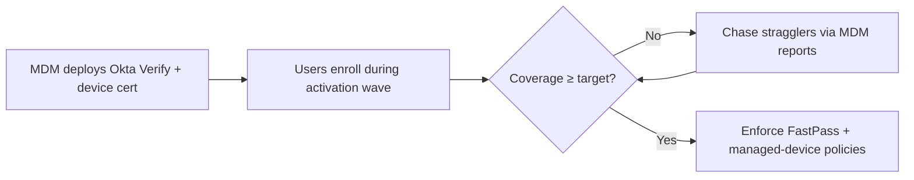

# Okta Tenant Setup, Policy & Okta Verify Rollout

> Values marked **(proposed)** are starting points for the policy workshop with Security/Compliance, not final decisions.
> Vendor-specific behavior marked **[verify]** should be confirmed against current Okta docs.

## 1. Tenant Setup

- **Orgs: build in prod, backport to sandbox after launch.**
  - **Why prod first:** the org is net new, so until real users are activated there's **no impact** from building there. Building a sandbox first costs time we don't have, and preview orgs run Okta's **upcoming release**, so results there can differ from prod (false positives).
  - **The "no impact" window ends** at the first of: Rippling syncing real users, activation emails going out, or any app/Google sign-in pointing at Okta. Those steps are deliberate, scheduled changes.
  - **After launch:** backport the prod configuration into a sandbox org and use it for testing changes. Still check results against prod behavior, since the sandbox runs ahead of prod.
  - **Test accounts in prod** are named and tagged as test accounts, tracked, and deactivated (or kept tagged and excluded from access reviews by documented exception) after launch. Untracked test accounts with access are an audit finding.
- **Org URL:** `ailense.okta.com` (the standard Okta subdomain). Users learn this one trusted URL (phishing awareness). A custom domain is optional and not planned.
- **Branding:** company sign-in page and email templates, so Okta emails don't look like phishing.
- **Admin roles:** least privilege from day one.

| Role | Holders | Notes |
| --- | --- | --- |
| Break-glass Super Admin | Initial org Super Admin account | See §2 |
| Super Admin | 1–2 named IT admins **(proposed)** | Kept minimal; used only when a task truly needs it |
| IT Admin (custom role) | IT team | Day-to-day admin work: apps, groups, users, no org-wide security settings |
| Help Desk (custom role) | IT support | Reset MFA/password, no policy or app config |
| Read-only Admin | Security / audit | Evidence collection |
| Integration service accounts | Rippling, SIEM, scripts | Scoped roles or OAuth service apps, not personal API tokens |

### Decision: no separate admin accounts for humans

Admins use **their regular Okta account**, with admin roles assigned to it. Separate admin accounts add friction and more accounts to manage, and the risks they used to address are covered by these **compensating controls**:

| Risk separate accounts addressed | Compensating control |
| --- | --- |
| Admin gets phished | Phishing-resistant MFA (FastPass / FIDO2) required for all admins |
| Daily session hijacked and used for admin actions | Okta Admin Console sign-in policy: phishing-resistant re-authentication **every time**, short admin session **(proposed: 30 min idle)**; enable Okta's admin session protections **[verify]** |
| Compromised admin laptop | Device trust required for the Admin Console once [MDM coverage](../../02-mdm-reenrollment/PLAN.md#definition-of-healthy) is in place; admins are IT, so their devices are healthy first |
| Too much standing privilege | Daily work uses **custom roles**, not Super Admin; Super Admin held by 1–2 people plus break-glass |
| Unnoticed privilege changes | [Security alerts](#security-alerting) on admin role assignments/changes and any Super Admin use; admin roles included in the quarterly access review |

**SOC 2:** SOC 2 requires least privilege, MFA, and restricted privileged access (CC6.1, CC6.3), not separate accounts. The controls above, documented with this rationale, cover it.

## 2. Super Admin & Break-glass Accounts

**Why break-glass matters:** if SSO, MFA, or a policy change locks admins out, these are the way back in.

- **The initial org Super Admin is the break-glass account.** The account used to create the Okta org isn't tied to any person and isn't used day to day.
- **Avoid a circular dependency:** the break-glass account's email and recovery must **not** depend on Okta. Once Google Workspace is federated to Okta, a mailbox behind Google SSO can't receive the reset email during an Okta outage. Use a mailbox that's excluded from SSO, or a separate domain.
- **Credentials:**
  - Documented in a restricted **1Password** break-glass vault (accessible only to Security + IT lead)
  - **1Password must stay reachable when Okta is down:** don't put its unlock behind Okta without an offline fallback ([postmortem item 10](../../01-incident-response/postmortem.md#action-items))
  - Sealed offline copy in a physical safe **(proposed)**
- **MFA:** **two FIDO2 hardware keys** enrolled on the account, stored in separate locations. One account is enough as long as losing a single key can't lock you out.
- **Exempt from** the policies most likely to lock them out (device trust, network zones), but **always** require MFA.
- **Monitoring:** any break-glass sign-in alerts Security immediately via an **Okta Workflow → Slack** (see [Security alerting](#security-alerting)).
- **Test quarterly:** sign in, verify, document. This produces SOC 2 evidence.
- **Google side too:** keep 2 Google Workspace super admins as break-glass. Google super admins don't sign in through third-party SSO, so they still work if Okta is down **[verify]**.

## 3. Policy Setup (with Security/Compliance)

**Process:** run a policy workshop with Security/Compliance in Phase 2. Record each decision with its rationale and the SOC 2 control it supports. The recorded decisions become audit evidence.

| Policy area | Proposed baseline | Rationale |
| --- | --- | --- |
| Password | Min 14 chars, block common/breached passwords, **no forced periodic rotation**, lockout after 10 failed attempts **(proposed)** | NIST 800-63B: length over complexity; rotation drives weak passwords |
| Authenticators allowed | Okta Verify (push with number challenge + FastPass), FIDO2/WebAuthn | Phishing-resistant options available |
| Authenticators disabled | SMS, voice, security questions; email as MFA factor | SIM swap and social engineering risk |
| Global session | MFA at every new sign-in; max session 12h, idle timeout 2h **(proposed)** | Balance security with daily friction |
| App sign-in tiers | **Standard:** any MFA. **Sensitive** (AWS, GitHub, NetSuite, etc.): phishing-resistant + managed device. **Okta Admin Console:** phishing-resistant, every time | Risk-tiered; maps to the app inventory |
| Network | Block anonymizers/Tor (dynamic zone); ThreatInsight enabled (log first, then block) | Credential-stuffing protection |
| Account recovery | Self-service via Okta Verify; help desk resets require **identity verification** (video call + manager confirm) **(proposed)** | Help desk social engineering is a top IdP attack path |
| Logging | **Alerts:** Okta Workflows → Slack now, SIEM when available. **Retention:** keep System Log ≥ 1 year **(proposed)**; until a SIEM exists, stream or export it to long-term storage (e.g., S3) **[verify]** | Okta keeps logs about 90 days **[verify]**; a Type II audit window needs evidence for the full period |

### Security alerting

**Now:** Okta Workflows trigger on System Log events and post to a Slack channel (e.g., `#security-alerts` **(proposed)**). **Future:** forward to a SIEM when one is available; the Slack alerts can stay as the fast notification path.

| Event | Why |
| --- | --- |
| Break-glass account sign-in | Should never happen outside an emergency or the quarterly test |
| Any Super Admin role use or assignment | Super Admin is kept to 1–2 people |
| Admin role assigned / removed | Privilege changes must be expected and approved |
| Sign-in, password, or authenticator policy changed | A weakened policy is a silent risk |
| MFA reset by help desk | Top social engineering path; spot unusual volume |
| Lifecycle Workflow failure ([04 ULM](../../04-hris-lifecycle-automation/PLAN.md)) | A failed offboarding means a leaver keeps access |

**Limits to note:** Slack alerts are notifications, not a log archive. They don't replace log retention for SOC 2 (see Logging above), and someone must own watching the channel.

### Policy testing (proposed)

Every policy is built and tested **in prod with dedicated test users**, before any real user is activated. Test users cover each persona: standard employee, contractor, admin, break-glass. After launch, policy changes are tested in the backported sandbox first, then re-run against prod with these same cases.

| Test | Expected result |
| --- | --- |
| Standard user signs in to a standard app | Okta Verify push (number challenge) accepted |
| Standard user signs in to a sensitive app with push only | Blocked; prompted for phishing-resistant factor |
| Admin opens the Okta Admin Console | Phishing-resistant factor required, every time |
| User tries to enroll SMS/voice/security question | Option not offered |
| Password below minimum length or on common-password list | Rejected |
| Session idle past timeout | Re-authentication required |
| Sign-in from an anonymizer/Tor | Blocked |
| Break-glass account signs in | Succeeds; Security alert fires |
| Help desk resets a user's MFA | Only possible via the custom help desk role; logged in System Log |
| Contractor past end date | Cannot sign in |

Results recorded with screenshots: they double as SOC 2 evidence that controls were tested before go-live.

**SOC 2 mapping:** these policies primarily support CC6.1 (logical access security), CC6.2 (user registration/authorization), CC6.3 (access modification/removal), and CC7.2 (monitoring).

## 4. Okta Verify Rollout (via MDM)

**Prerequisite:** workstream 02 (MDM re-enrollment) is complete, so every macOS and Windows machine is enrolled and healthy.

**Why Okta Verify first:** it unlocks the later capabilities.

- **FastPass:** passwordless, phishing-resistant sign-in
- **Device Assurance:** OS version, disk encryption, screen lock checks
- **Managed device conditions** in sign-in policies (the "Sensitive" tier above)
- **Future:** desktop MFA and password sync at the OS sign-in **[verify]**

### Rollout steps

1. **Package and deploy** Okta Verify silently through MDM (macOS and Windows), preconfigured with the org URL where supported **[verify]**.
2. **Managed device signal:** deploy the device management certificate via Iru so Okta can tell managed devices from unmanaged ones **[verify]**. Tracked in [Iru + Okta device management integration](#iru--okta-device-management-integration).
3. **Enroll:** users enroll Okta Verify on mobile (MFA) and desktop (FastPass) during their activation wave. End-user guide: [user-guide-okta-setup.md](../user-guide-okta-setup.md).
4. **Phase it:** IT pilot → early adopters → by department, in step with the user activation waves.
5. **Measure:** % of users enrolled and % of devices reporting as managed ([Get-OktaManagedDeviceReport.ps1](../scripts/Get-OktaManagedDeviceReport.ps1)). Don't enforce FastPass or managed-device policies until coverage is high enough **(proposed: 95%+)**.
6. **Enforce:** turn on the "Sensitive" tier policies once coverage is reached. Set up an exception process for stragglers.

### Device trust phasing

**Not a day-1 requirement.** SOC 2 doesn't require it, and enforcing it during the migration would tie sign-in to MDM health.

| Stage | Scope | Requirement |
| --- | --- | --- |
| Day 1 | All apps | MFA (Okta Verify) |
| Day 1 | Admins + sensitive tier | Phishing-resistant MFA (FastPass / FIDO2) |
| Post-migration | Sensitive tier: Okta Admin Console, AWS prod, GitHub **(proposed)** | Managed device required, once coverage target is met |
| Later, if needed | Other apps | Only if the gap assessment (05) or Security requires it |

**Certificate rollout** for the managed-device signal is deployed via MDM in step 2 above. It isn't enforced until the post-migration stage.

### Iru + Okta device management integration

**Goal:** Okta can tell an Iru-managed device from any other device, so sign-in policies can require a managed device for the sensitive tier.

**Timing:** add the certificate profile to **Iru's baseline before MDM migration wave 2**, so devices land in Iru already carrying it. Adding it after the migration means a second push to the whole fleet. Configuring it early is safe because nothing is **enforced** until the post-migration stage.

| # | Task | System | Timing | Status |
| --- | --- | --- | --- | --- |
| 1 | Enable device management integration; decide certificate authority (Okta as CA vs. our own CA via SCEP) **[verify]** | Okta | Phase 2 | Not started |
| 2 | Create certificate (SCEP) profiles for macOS and Windows pointing at Okta | Iru | Before MDM wave 2 | Not started |
| 3 | Deploy Okta Verify with managed configuration (org URL) | Iru | Before MDM wave 2 | Not started |
| 4 | Define Device Assurance policies (OS version, disk encryption, screen lock) **matching Iru's compliance policies**, so the two systems don't disagree about what "healthy" means | Okta + Iru | Phase 2 | Not started |
| 5 | Test with a test user: managed device passes, unmanaged/personal device blocked from a sensitive-tier test app | Okta prod (test users) | Phase 2 | Not started |
| 6 | Measure: users with a managed device ([Get-OktaManagedDeviceReport.ps1](../scripts/Get-OktaManagedDeviceReport.ps1)) vs. devices healthy in Iru ([device tracker](../../02-mdm-reenrollment/device-tracker.csv)); investigate gaps | Okta + Iru | During activation | Not started |
| 7 | Enforce managed device on the sensitive tier once coverage target is met | Okta | Post-migration | Not started |

## Decisions to Confirm

- Final session and password values (policy workshop)
- Help desk identity verification procedure
- SIEM selection (future) and long-term log storage until then
- Okta Verify enforcement threshold and exception process
