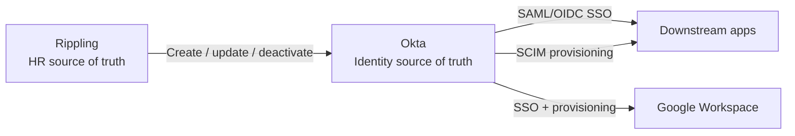
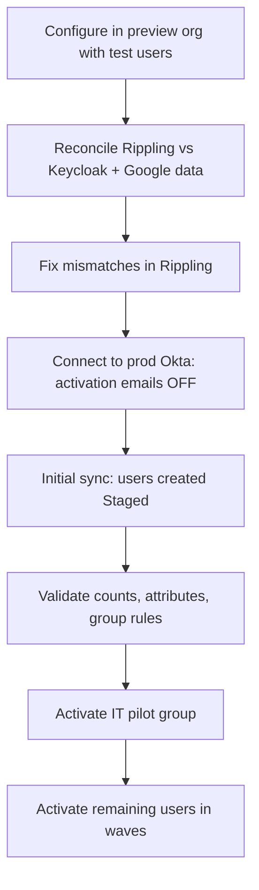

# Rippling → Okta Integration

> Applies when Rippling exists as the HR source of truth. See [PLAN.md](../PLAN.md#branch-hr-source-of-truth).
> Vendor-specific behavior marked **[verify]** should be confirmed against current Rippling/Okta docs and the actual tenants.

## Target Architecture

- **Rippling owns people data** (who exists, job attributes, start/end dates).
- **Okta owns identity** (credentials, MFA, groups, app access).
- **Apps receive** identity from Okta, never directly from Rippling, so there's one place to audit access.
- Rippling should **not** keep direct app provisioning for apps that move behind Okta. Two provisioners for the same app cause conflicts and confuse audits.

## Schema Mapping

**Key principle:** match users on an **immutable ID** (`employeeNumber`), not email. Emails change (name changes, domain changes); employee IDs don't.

| Rippling field | Okta attribute | Notes |
| --- | --- | --- |
| Employee ID | `employeeNumber` | Immutable match key |
| Work email | `login`, `email` | Username = work email |
| Legal first / last name | `firstName`, `lastName` | |
| Preferred first name | `nickName` / `displayName` | Prefer for display to avoid deadnaming |
| Personal email | `secondEmail` | Pre-hire activation only; decide with Security whether to store it at all |
| Job title | `title` | |
| Department | `department` | Drives group rules |
| Manager | `managerId` (+ `manager`) | Use manager's employee ID, not name |
| Manager work email | custom `managerEmail` | Used by [04 ULM](../../04-hris-lifecycle-automation/PLAN.md) Workflows: offboarding Drive/Calendar transfer, mail-continuity DL membership, notifications. Kept alongside `managerId` so Workflows don't need an extra lookup |
| Employment type (FTE / contractor / intern) | `userType` | Drives group rules and policy |
| Work location / country | `city`, `countryCode` | Region-based access/policy if needed |
| Cost center | `costCenter` | Optional; license chargeback |
| Start date | custom `startDate` | Drives pre-hire activation timing |
| Termination date | custom `terminationDate` | Audit trail for deprovisioning SLA |
| Employment status | custom `employmentStatus` | Active / leave / terminated |

**Attribute ownership:** Rippling masters everything above. Okta masters only identity fields (groups, authenticators, app assignments). No attributes should be edited by hand in Okta. If a value is wrong, fix it in Rippling.

## Lifecycle Events

| Event | Rippling trigger | Okta result |
| --- | --- | --- |
| Pre-hire | Up to 4 days before start date | User created **Provisioned**; Rippling activates. Workflow adds them to **Pre-start Limited Access** (excluded from group rules). See [04 ULM](../../04-hris-lifecycle-automation/PLAN.md#joiner-pre-start-access) |
| Day 1 | Start date has passed | Workflow removes them from the limited group → group rules assign birthright apps |
| Mover | Dept / title / manager change | Attributes update → group rules re-evaluate → access added/removed |
| Leave of absence | Status = leave | Decide with Security: suspend vs. keep active _OPEN_ |
| Planned termination | Rippling termination | Rippling **suspends** Okta user → offboarding Workflow deactivates Okta + offboards Google. See [04 ULM](../../04-hris-lifecycle-automation/PLAN.md#leaver-offboarding) |
| Urgent termination | Same-day / involuntary | Terminate in Rippling immediately, or **suspend** in Okta, so the same offboarding Workflow runs. A manual *deactivation* would skip the Google steps |
| Rehire | Returning employee | Reactivate existing Okta user (same `employeeNumber`), don't create a duplicate |
| Contractor | _OPEN_: in Rippling or not? | If not in Rippling, needs a separate Okta-mastered process with a required end date |

## Configuration Best Practices

1. **Build in a non-production Okta org first** (Okta preview/sandbox org) with test users before touching production.
2. **Disable automatic activation emails** before the first sync. A misconfigured first sync can email 400 people at once.
3. **Run a reconciliation before go-live:** compare the Rippling export against Keycloak users ([identity-reconciliation.md](identity-reconciliation.md)). Fix name/email mismatches in Rippling first, and decide what happens to identities HR doesn't manage.
4. **Link, don't duplicate:** existing Google accounts must match the Rippling-created Okta users by email when the Okta → Google Workspace app is connected. Check matches in the import screen before confirming anything.
5. **Use a dedicated integration service account** with the least-privileged admin role the integration supports **[verify]**. Store its credential in the restricted vault (see [okta-tenant-setup.md](okta-tenant-setup.md#super-admin--break-glass-accounts)) and rotate it on a schedule.
6. **Group rules on attributes, not manual membership:** `department`, `userType`, `countryCode` → birthright groups. This is what fixes the "hand-maintained group" problems in the [app inventory](../../app-inventory.md).
7. **Time zones:** confirm what time terminations take effect (midnight in which time zone?) **[verify]**.
8. **Monitor sync failures:** alert on errors from the integration in the Okta System Log. A silent sync failure means a terminated user keeps access.

## Rollout Sequence

## _OPEN_

- Does Rippling act as a true profile master in Okta, or a push-only integration? Affects whether Okta edits get overwritten **[verify]**
- Contractor and intern handling
- Leave-of-absence policy
- Termination SLA target (e.g., access removed within X hours), which becomes SOC 2 evidence
