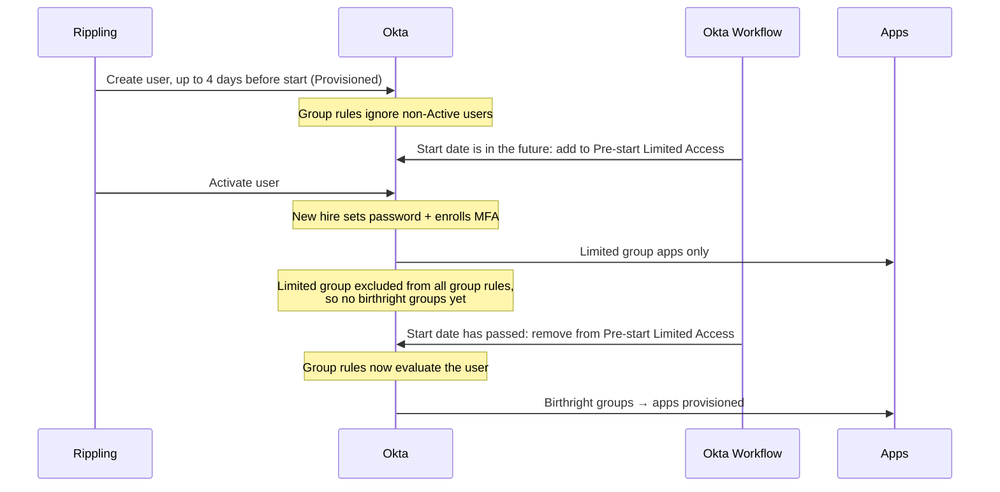
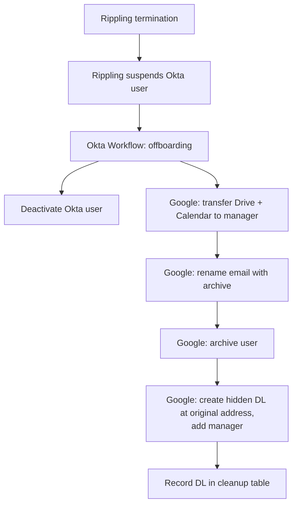

# User Lifecycle Management: Rippling → Okta → Apps

> **Status:** Working draft. Describes the joiner and leaver automation that goes live with Okta ([03 IdP migration](../03-identity-sso-migration/PLAN.md)).
> Items marked **(proposed)** are additions for discussion; **[verify]** = confirm against current vendor docs.

## Overview

| Event | Trigger | Automation |
| --- | --- | --- |
| **Pre-hire** | Rippling creates the user, up to 4 days before start date | Okta Workflow puts them in a **Pre-start Limited Access** group, excluded from all group rules |
| **Day 1** | Start date reached | Workflow removes them from the limited group, so group rules grant birthright access |
| **Leaver** | Rippling termination suspends the Okta user | Workflow deactivates Okta and offboards Google (data transfer, archive, mail continuity) |
| **Leaver + 90 days** | Scheduled | Workflow notifies, then cleans up the leaver's mail-continuity group |

Attribute mapping from Rippling to Okta: [rippling-okta-integration.md](../03-identity-sso-migration/docs/rippling-okta-integration.md#schema-mapping).

## Joiner: Pre-start Access

**Goal:** new hires can get into a small set of apps (e.g., onboarding paperwork) before day 1, **without** getting their full birthright access early.

### Building blocks

| Component | Behavior |
| --- | --- |
| **Rippling → Okta** | Creates the user up to **4 days before start date** with mapped attributes. User is **Provisioned** (exists, password not set yet). **Rippling also activates the user** |
| **Okta group rules** | **Ignore users who aren't Active**, so a Provisioned user gets no birthright groups |
| **Pre-start Limited Access group** | Assigned a **subset of apps** we want new hires to reach before their start date. Its group ID is **excluded from every dynamic group rule**, so members stay out of birthright groups even after they activate and set a password |
| **Okta Workflow: pre-start** | Reads the user's start date. Adds pre-start users to the limited group; **removes them once their start date has passed** |

### Flow

### Pre-start apps

_OPEN:_ which apps are in the limited group. Typical candidates: Rippling (onboarding paperwork, benefits), the Okta dashboard itself, security awareness training.

## Leaver: Offboarding

**Trigger:** a Rippling termination **suspends** the Okta user. The suspension event triggers the offboarding Workflow.

### Actions

| # | System | Action |
| --- | --- | --- |
| 1 | Okta | **Deactivate the user** (ends Okta sessions; SCIM-connected apps deprovision) |
| 2 | Google | **Transfer Drive files** to the manager |
| 3 | Google | **Transfer Calendar** to the manager |
| 4 | Google | **Rename the email address**: append `archive` (e.g., `jane.doe@` → `jane.doe.archive@`) |
| 5 | Google | **Archive the user** |
| 6 | Google | **Create a new group (DL)** using the user's **original email address**, **hidden from the global address list**, with the **manager as a member**, so mail sent to the leaver keeps reaching someone |

### 90-day DL cleanup

- A scheduled Workflow finds mail-continuity DLs that are reaching **90 days** after the user departed.
- It **notifies the DL members** so they can alert IT if the group is still needed past 90 days.
- If nobody asks to keep it, the DL is **deleted at 90 days**.

**Proposed details:**

- Track each DL in an Okta Workflows **table**: original address, manager, created date, delete date, extended (yes/no)
- Send the notice **14 days before** deletion, so there's time to respond
- An extension is a deliberate IT action with a new delete date, not "keep forever"

## Design Considerations (proposed)

These are the details most likely to bite. Each should be confirmed when the Workflows are built.

| # | Consideration | Why it matters |
| --- | --- | --- |
| 1 | **Order of operations in offboarding.** If Okta's Google Workspace app is set to deprovision users on deactivation, deactivating Okta **first** may suspend or delete the Google user **before** the Drive/Calendar transfer runs **[verify]** | Data loss for the manager. Either do the Google steps first and deactivate Okta last, or let the Workflow own Google offboarding and turn off Google deprovisioning in the Okta app |
| 2 | **Freeing the original address.** Google typically keeps the old address as an **alias** after a rename **[verify]**. The alias must be removed before a group can be created with that address | Otherwise step 6 fails |
| 3 | **Google sessions.** Deactivating Okta ends Okta sessions, but an existing Google session can live on | Add a step: sign the user out of Google and revoke app tokens/app passwords |
| 4 | **Urgent terminations.** The Workflow triggers on **suspension**. If IT manually **deactivates** in Okta during an urgent termination, the Google steps won't run | The urgent-termination runbook should be: terminate in Rippling immediately (or suspend in Okta), so the same Workflow runs |
| 5 | **Pre-start timing.** When does the "start date has passed" check run, and in which time zone? | A daily run at the wrong hour gives a new hire in another time zone no access on their first morning. Run it early (or hourly) in the earliest company time zone |
| 6 | **Start date changes.** Rippling start dates move (offer delays, early starts) | The pre-start Workflow must re-read the start date, not just act once at creation |
| 7 | **Pre-start group exclusion.** Every *new* group rule must also exclude the limited group | Add it to the group-rule checklist; one missed rule leaks birthright access early |
| 8 | **Workflow failures.** A failed offboarding run means a leaver keeps access or loses data | Alert IT on any failed execution; review run history weekly |

## Testing (proposed)

| Test | Expected result |
| --- | --- |
| Rippling creates a hire with start date in 4 days | Okta user Provisioned; added to Pre-start Limited Access; no birthright groups |
| New hire activates and sets password before start date | Sees only the limited apps |
| Start date passes | Removed from limited group; birthright groups and apps assigned |
| Start date moved later in Rippling | Stays in the limited group until the new date |
| Rippling termination | Okta user suspended → Workflow runs → all 6 actions complete |
| Mail to the leaver's original address | Delivered to the manager via the hidden DL; DL not visible in the address list |
| DL at 76 days | Members notified |
| DL at 90 days, not extended | Deleted |
| Workflow step fails | IT alerted |

## SOC 2 Relevance

- **CC6.2 (provisioning):** access is granted from HR records via group rules, not ad hoc requests. Pre-start access is limited by design.
- **CC6.3 (removal):** termination in Rippling removes access automatically. Workflow run history is the evidence of **timely deprovisioning**. Export it, since run history retention is limited **[verify]**.

## _OPEN_

- Pre-start app list
- **Mover** flow: department/manager changes re-evaluate group rules automatically; does anything else need to happen (e.g., Drive ownership, access review)?
- **Rehire** flow: reactivate the existing Okta user and un-archive Google, or start fresh?
- **Contractors:** not in Rippling today; need their own end-date-driven leaver flow ([identity-reconciliation.md](../03-identity-sso-migration/docs/identity-reconciliation.md))
- Leaver steps for non-Google apps that don't support SCIM (manual checklist from the [app inventory](../app-inventory.md))
- Offboarding SLA target (e.g., access removed within 1 hour of termination)
