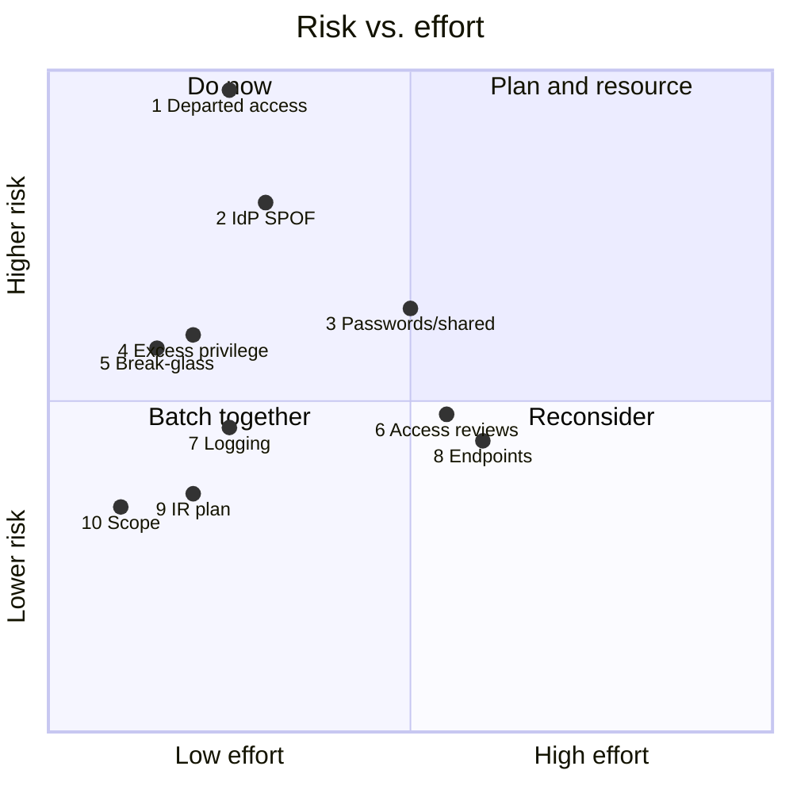

# Security Gap Assessment: Top 10 Fixes Before the SOC 2 Audit

> **Status:** Working draft. Findings come from the other workstreams (linked as evidence); scores are proposed for review with Security/Compliance.
> Runs **in parallel** with the [IdP migration](../03-identity-sso-migration/PLAN.md) and fills time while waiting on app owners.

## Method

Each gap is scored on:

| Factor | Scale | Meaning |
| --- | --- | --- |
| **Likelihood** | 1–5 | How likely the gap is exploited or causes an incident in the next 6 months |
| **Impact** | 1–5 | Damage if it happens (data exposure, outage, audit failure) |
| **Risk** | 1–25 | Likelihood × Impact. **Primary ranking** |
| **Audit exposure** | High / Med / Low | How likely an auditor finds it and reports an exception. **Tie-breaker** |
| **Effort** | Low / Med / High | Low = days, Med = weeks, High = a project |

**Timing** is set against the SOC 2 Type II observation window ([program timeline](../README.md#proposed-timeline)): fixes that produce evidence must be **in place before the window starts**; others can land during it if the change is documented.

## Top 10

| # | Gap | Evidence | SOC 2 | L | I | Risk | Audit | Effort | Fix | Owner | When |
| --- | --- | --- | --- | --- | --- | --- | --- | --- | --- | --- | --- |
| 1 | **Departed users still have access** | 6 departed users active in Salesforce, departed admin in CrowdStrike, terminated users active in Keycloak, 6 departed-employee devices ([inventory](../app-inventory.md#assignment-review), [reconciliation](../03-identity-sso-migration/docs/identity-reconciliation.md), [device tracker](../02-mdm-reenrollment/migration-status.md)) | CC6.2, CC6.3 | 5 | 5 | **25** | High | Low → Med | **Now:** access sweep, disable all terminated accounts, recover hardware. **Lasting:** HR-driven offboarding ([04 ULM](../04-hris-lifecycle-automation/PLAN.md)) | IT | Sweep: week 1. ULM: before window |
| 2 | **IdP is a single point of failure with no owner** | 3-hour outage from an expired, unmonitored certificate ([postmortem](../01-incident-response/postmortem.md)) | CC7.2, A1.2 | 4 | 5 | **20** | High | Low → High | **Now:** inventory and monitor every Keycloak certificate, name an owner (postmortem item 1). **Lasting:** migrate to Okta ([03](../03-identity-sso-migration/PLAN.md)) | IT Lead | Interim: week 1 |
| 3 | **Password-only and shared logins on in-scope apps** | Salesforce, Zendesk, NetSuite on passwords; Zendesk shared agent logins; Mailchimp shared account ([inventory](../app-inventory.md)) | CC6.1 | 4 | 4 | **16** | High | Med | **Now:** turn on app-native MFA where available, move shared credentials into 1Password and rotate them. **Lasting:** Priority 1 Okta apps with individual accounts | IT + app owners | MFA: weeks 1–2. Okta: before window |
| 4 | **Excess privilege** | Non-engineers in `eng-aws-admins`; one GitHub group grants all repos; domain-wide sign-in for Slack and Datadog ([inventory](../app-inventory.md#assignment-review)) | CC6.1, CC6.3 | 3 | 5 | **15** | High | Low | Remove non-engineers from AWS admin now; restrict Datadog to Engineering; GitHub team-based access as part of migration | DevOps Lead + IT | AWS: week 1. Rest: before window |
| 5 | **No tested break-glass or admin recovery** | AWS root MFA key in the office safe; single GitHub org owner; one Google super admin online during the outage ([postmortem](../01-incident-response/postmortem.md#how-we-regained-admin-access)) | CC7.5, A1.2 | 3 | 5 | **15** | Med | Low | Second AWS root MFA key off-site; second GitHub owner; second Google super admin; documented recovery path per critical app (postmortem items 4, 8, 9) | IT + Security | Weeks 1–2 |
| 6 | **No periodic access reviews** | 9 of 18 apps have the wrong people assigned ([inventory summary](../app-inventory.md#summary)) | CC6.2, CC6.3 | 4 | 3 | **12** | **High** | Med | Run a first review with app owners now (the inventory's assignment review is the starting point); quarterly cadence after; include admin roles | IT + Compliance | First review before window |
| 7 | **Logs not retained long enough; no security alerting** | No SIEM; Okta keeps logs about 90 days; no alerting on admin changes ([tenant setup](../03-identity-sso-migration/docs/okta-tenant-setup.md#security-alerting)) | CC7.2 | 3 | 4 | **12** | **High** | Low | Export/stream logs to long-term storage (≥ 1 year); Okta Workflows → Slack alerts for admin and break-glass events | IT + Security | Before window |
| 8 | **Endpoint gaps** | Devices missing CrowdStrike; recovery keys not yet escrowed in Iru; devices unreachable by any management tool ([MDM status](../02-mdm-reenrollment/migration-status.md)) | CC6.8, CC6.7 | 3 | 4 | **12** | Med | Med | Finish MDM migration ([02](../02-mdm-reenrollment/PLAN.md)); chase every EDR gap individually; confirm key escrow per device | IT | Before window |
| 9 | **Incident response not documented or tested** | No help desk escalation trigger; communications depended on the IdP; no out-of-band channel ([postmortem](../01-incident-response/postmortem.md#action-items)) | CC7.3–CC7.5 | 3 | 3 | **9** | **High** | Low | Written IR plan with severity levels and escalation triggers; out-of-band comms channel; one tabletop exercise (the outage is a ready-made scenario) | Security + IT | Plan: before window. Tabletop: during |
| 10 | **Audit scope not settled; app inventory incomplete** | 4 apps pending a SOC 2 scope decision; password apps likely incomplete ([inventory](../app-inventory.md#inventory-completeness)) | CC2.1, CC3.2 | 3 | 3 | **9** | **High** | Low | Compliance decides the 4 pending apps; run password-app discovery (expense data, 1Password vaults, device app inventory, department survey) | Compliance + IT | Before window |

## Quick Wins: Week 1

Low-effort fixes that remove the most risk immediately, before the bigger projects land:

- [ ] Disable every terminated account found so far (Salesforce, CrowdStrike, Keycloak) — **#1**
- [ ] Inventory and alert on every Keycloak certificate; name an owner — **#2**
- [ ] Remove non-engineers from `eng-aws-admins` — **#4**
- [ ] Second AWS root MFA key off-site; second GitHub owner; second Google super admin — **#5**
- [ ] Move shared logins into 1Password and rotate them — **#3**
- [ ] Start exporting logs to long-term storage — **#7**

## Considered, Not in the Top 10

| Gap | Why it's not top 10 |
| --- | --- |
| Device trust not enforced | Deliberately deferred; SOC 2 doesn't require it ([decision](../03-identity-sso-migration/PLAN.md#phase-2-foundation)) |
| No SIEM | Covered for now by log retention + Slack alerts (#7); a SIEM is a later improvement |
| Unused paid seats (e.g., Figma) | Cost issue, not a security gap; handled in the access review (#6) |
| Local admin rights on laptops | Not yet measured; add to MDM health data, then re-score |
| Vendor risk management (SOC 2 reports from key vendors) | Likely an audit request; not assessed here. Flag for Compliance |

## _OPEN_

- Confirm scores and owners with Security/Compliance
- Confirm the observation window start date (drives every "before window" deadline)
- Re-score after week 1 quick wins
