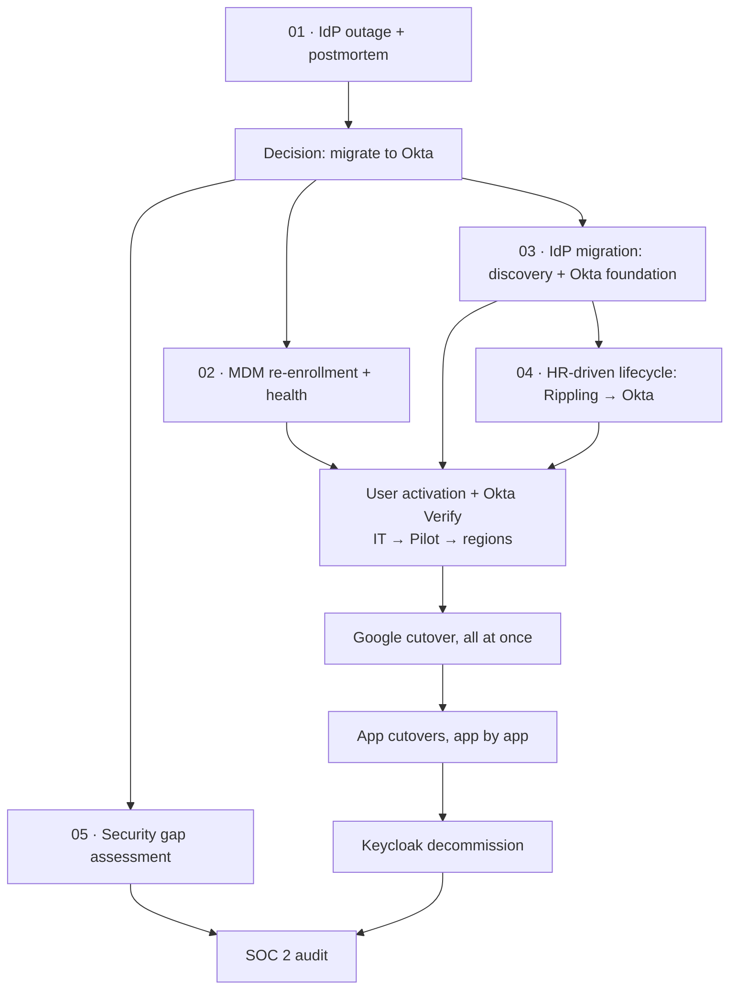
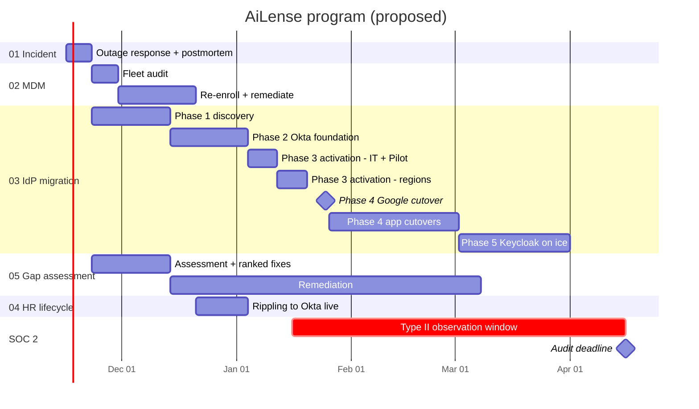

# AiLense: SOC 2 Readiness & Identity Modernization

Responses to the five prompts in [Prompt.jpg](Prompt.jpg). The prompts read as a menu; this response addresses **all five as one connected program** at **AiLense**, because in practice they depend on each other: the outage drives the migration, MDM gates Okta, Okta enables HR-driven lifecycle, and all of it feeds the SOC 2 audit.

## Scenario

1. AiLense has a **5-month SOC 2 deadline**.
2. A **3-hour outage of our current IdP** is the catalyst to migrate to a new IdP. Today's IdP is a **self-hosted SAML IdP (Keycloak)**, and Google Workspace and the other apps federate to it. Root cause: the IdP's **SAML signing certificate expired**. Nobody owned renewal, nothing monitored expiry, and recovery meant updating the new certificate in every app one by one.
3. We're moving to **Okta**, which also gives us **HR-driven identity** and **attribute-based access control (ABAC)**.
4. Rolling out Okta requires **Okta Verify**, which requires healthy MDM. MDM hygiene has historically been poor, so we're **moving from JumpCloud to Iru**, and **every machine must be properly enrolled and healthy before the Okta rollout**.
5. The **IdP migration runs in parallel with the security gap assessment**, so we're productive while waiting on app owners.
6. **Okta onboarding and the HR-driven user lifecycle go live at about the same time.**

## Program Flow

## Walkthrough

A suggested order for presenting (about 25 minutes). Each step links to the most relevant section.

| # | Topic | Talking point | Detail |
| --- | --- | --- | --- |
| 1 | **Scenario** | One startup, one program: SOC 2 deadline + an IdP outage as the catalyst | [Scenario](#scenario), [Program flow](#program-flow) (above) |
| 2 | **The outage** | Expired cert → partial outage → rotation made it total → 3 hours restoring app by app. Admins couldn't get into apps to fix them | [Postmortem](01-incident-response/postmortem.md), especially [how admins regained access](01-incident-response/postmortem.md#how-we-regained-admin-access) |
| 3 | **App inventory** | SSO apps known from the outage; password apps need discovery; Compliance sets SOC 2 scope, which sets Okta priority | [Scoping & priority](app-inventory.md#compliance-scoping--okta-priority), [SSO and SCIM](app-inventory.md#sso-and-scim), [assignment review](app-inventory.md#assignment-review) |
| 4 | **MDM first** | Okta Verify needs healthy devices: JumpCloud → Iru via Apple deadline migration, scripts, and CrowdStrike for stragglers; 95% healthy gate | [Migration paths](02-mdm-reenrollment/PLAN.md#migration-paths), [status snapshot](02-mdm-reenrollment/migration-status.md), [user guides](02-mdm-reenrollment/user-guide-mac-migration.md) |
| 5 | **Okta migration** | Discovery → foundation (built in prod) → activation by region → Google all at once → apps one by one (SSO + SCIM) → Keycloak on ice. Groups rebuilt from attributes; admin groups stay manual | [Phases](03-identity-sso-migration/PLAN.md#phase-2-foundation), [cutover runbook](03-identity-sso-migration/PLAN.md#phase-4-sign-in-cutover), [group migration](03-identity-sso-migration/docs/group-migration.md), [tenant setup](03-identity-sso-migration/docs/okta-tenant-setup.md) |
| 6 | **HR-driven lifecycle** | Pre-start limited access; offboarding triggered by deactivation from any source | [Pre-start flow](04-hris-lifecycle-automation/PLAN.md#joiner-pre-start-access), [offboarding](04-hris-lifecycle-automation/PLAN.md#leaver-offboarding), [design considerations](04-hris-lifecycle-automation/PLAN.md#design-considerations-proposed) |
| 7 | **Gap assessment** | Top 10 fixes ranked by risk, mostly found by the other workstreams; week-1 quick wins | [Top 10](05-security-gap-assessment/PLAN.md#top-10), [week-1 quick wins](05-security-gap-assessment/PLAN.md#quick-wins-week-1) |
| 8 | **Timeline & SOC 2** | Type II window starts mid-January with documented control changes | [Timeline](#proposed-timeline), [Type II decision](#decision-soc-2-type-ii-observation-window) |
| 9 | **MVP vs. later** | What must be true for the audit vs. what's burned down after; if an auditor tests it or it caused the outage, it's MVP | [Scope](#scope-mvp-before-the-audit-vs-post-audit-backlog) |

## Key Decisions

| Decision | Why | Where |
| --- | --- | --- |
| Move from self-hosted Keycloak to Okta | We owned the outage's root cause; a managed IdP removes the single point of failure and adds HR-driven lifecycle and ABAC | [Postmortem](01-incident-response/postmortem.md) |
| SOC 2 scope decides Okta priority | SOC 2 apps first, then existing SSO apps (needed to retire Keycloak), then the rest | [App inventory](app-inventory.md#compliance-scoping--okta-priority) |
| MDM health gates Okta Verify | Okta Verify and device signals need managed, healthy devices | [MDM plan](02-mdm-reenrollment/PLAN.md) |
| Build Okta in prod, backport to sandbox later | Net-new org has no impact until users activate; preview orgs run a future release and can mislead | [Tenant setup §1](03-identity-sso-migration/docs/okta-tenant-setup.md#1-tenant-setup) |
| No separate admin accounts | Phishing-resistant MFA, admin console step-up, custom roles, and alerts cover the risk | [Tenant setup §1](03-identity-sso-migration/docs/okta-tenant-setup.md#decision-no-separate-admin-accounts-for-humans) |
| Device trust not on day 1 | SOC 2 doesn't require it; enforcing it mid-migration would lock out anyone MDM missed | [IdP plan](03-identity-sso-migration/PLAN.md#phase-2-foundation) |
| Google cutover all at once | Per-group cutover confuses users and support; for users it's just a different sign-in check | [IdP Phase 4](03-identity-sso-migration/PLAN.md#phase-4-sign-in-cutover) |
| Offboarding triggers on deactivation | Runs whether Rippling or IT deactivates the user | [ULM plan](04-hris-lifecycle-automation/PLAN.md#leaver-offboarding) |
| Alerts via Okta Workflows → Slack; SIEM later | Fast to stand up; log retention handled separately (Okta keeps only 90 days) | [Tenant setup](03-identity-sso-migration/docs/okta-tenant-setup.md#security-alerting) |
| Type II window starts mid-January | Keeps the deadline; control changes are documented as Okta replaces Keycloak | [Decision](#decision-soc-2-type-ii-observation-window) |

## Scope: MVP Before the Audit vs. Post-Audit Backlog

**MVP** is what must be true for the SOC 2 Type II window and to remove the outage's single point of failure. Everything else is planned, owned, and burned down after the audit.

| Area | MVP: before / during the observation window | Post-audit backlog |
| --- | --- | --- |
| **Identity** | Okta live for all users; MFA everywhere, phishing-resistant for admins; Google + all Keycloak SSO apps moved; Priority 1 (SOC 2) apps on Okta with SCIM where supported | Priority 3 password apps (SSO, vaulting, or retire); sandbox org backport; passwordless (FastPass) for everyone |
| **Groups** | Access and org-structure groups rebuilt in Okta; privileged groups approved member by member | Google collaboration group cleanup; finer-grained team groups (e.g., GitHub) |
| **Lifecycle** | Rippling-driven joiner/leaver with offboarding Workflows; terminated-user sweep done | Mover and rehire flows; contractors into Rippling; access requests and certifications tooling |
| **Devices** | MDM migration ≥ 95% healthy; EDR on every device; encryption keys escrowed in Iru | Device trust enforced on the sensitive tier; desktop MFA / password sync; local admin rights cleanup |
| **Monitoring** | Logs kept 365 days (both IdPs); Okta Workflows → Slack alerts | SIEM |
| **Process** | First access review done, quarterly cadence set; IR plan written; break-glass and admin recovery paths tested; control change log | Recurring tabletop exercises; shadow-IT discovery as a standing process; license cleanup |
| **Decommission** | Keycloak frozen with no apps on it | Keycloak shut down after the 30-day log check; JumpCloud retired |

**Rule of thumb:** if an auditor will test it during the window, or it removes the risk that caused the outage, it's MVP.

## Proposed Timeline

> Assumes a Nov 16, 2026 kickoff and a SOC 2 deadline 5 months out.

## Decision: SOC 2 Type II Observation Window

**The tension:** a Type II audit needs an observation period (often 3+ months) with controls operating throughout. Working backward from a mid-April deadline, the window starts around **mid-January**, while the Okta rollout is still in progress.

**Options considered:**

- **(a) Start the window mid-January with current controls, and document each change as Okta replaces them** ← **chosen**
- (b) Type I first, then Type II
- (c) Negotiate a shorter first observation period with the auditor

**Why (a):** control changes during an observation window are normal as long as they're documented. It keeps the original deadline, and the controls get *stronger* during the window (Keycloak → Okta, manual → HR-driven offboarding), which is a good story for the auditor.

**What it requires:**

- The [gap assessment](05-security-gap-assessment/PLAN.md)'s "before window" fixes land by mid-January, so the window starts with defensible controls
- A **change log** of every control change during the window (what, when, approver, evidence before and after)
- **Log retention for both IdPs** across the whole window: Keycloak logs exported, Okta logs kept for 365 days (Okta retains only 90 days on its own)

Late-December holidays and change freezes squeeze the MDM and Okta foundation work, so those dates have the least slack.

## Workstreams

| # | Workstream | Prompt | Role in the program | Folder |
| --- | --- | --- | --- | --- |
| 01 | Incident response | Handle a 3-hour IdP outage | **Trigger:** postmortem makes the case for migrating | [01-incident-response](01-incident-response/postmortem.md) |
| 02 | MDM re-enrollment | Re-enroll a mixed macOS/Windows fleet | **Prerequisite:** healthy fleet before Okta Verify | [02-mdm-reenrollment](02-mdm-reenrollment/PLAN.md) |
| 03 | Identity/SSO migration | Migrate 400 people between IdPs, 5-month SOC 2 deadline | **Core project** | [03-identity-sso-migration](03-identity-sso-migration/PLAN.md) |
| 04 | HRIS-driven lifecycle | HRIS-driven onboarding/offboarding flow | **Goes live with Okta**: joiner/leaver automation | [04-hris-lifecycle-automation](04-hris-lifecycle-automation/PLAN.md) |
| 05 | Security gap assessment | Prioritize the top 5–10 fixes before an audit | **Parallel** with 03 | [05-security-gap-assessment](05-security-gap-assessment/PLAN.md) |

## Shared Artifacts

- **[App inventory](app-inventory.md):** every app, how users sign in, SOC 2 scope, Okta priority, and assignment review. Used by the postmortem, IdP migration, and gap assessment.
