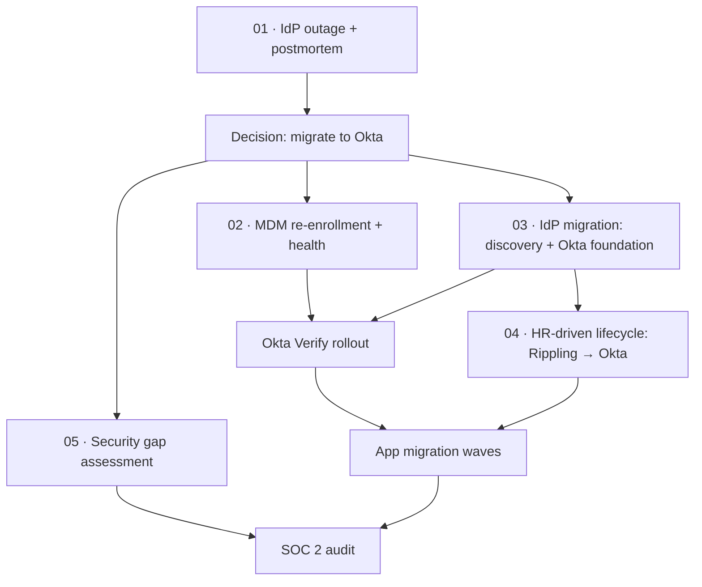
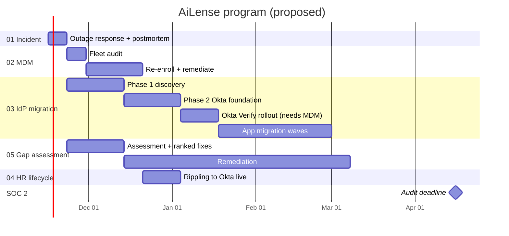

# AiLense: SOC 2 Readiness & Identity Modernization

Work trial response. Original prompts: [Prompt.jpg](Prompt.jpg).

All five prompts are treated as **one connected program** at a single fictional startup, **AiLense**, rather than five separate exercises.

## Scenario

1. AiLense has a **5-month SOC 2 deadline**.
2. A **3-hour outage of our current IdP** is the catalyst to migrate to a new IdP. Today's IdP is a **self-hosted SAML IdP (Keycloak)**, and Google Workspace and the other apps federate to it. Root cause: the IdP's **SAML signing certificate expired**. Nobody owned renewal, nothing monitored expiry, and recovery meant updating the new certificate in every app one by one.
3. We're moving to **Okta**, which also gives us **HR-driven identity** and **attribute-based access control (ABAC)**.
4. Rolling out Okta requires **Okta Verify**, which requires healthy MDM. MDM hygiene has historically been poor, so we're **moving from JumpCloud to Iru**, and **every machine must be properly enrolled and healthy before the Okta rollout**.
5. The **IdP migration runs in parallel with the security gap assessment**, so we're productive while waiting on app owners.
6. **Okta onboarding and the HR-driven user lifecycle go live at about the same time.**

## Shared Artifacts

- **[App inventory](app-inventory.md):** every app, how users sign in, SOC 2 scope, Okta priority, and assignment review. Used by the postmortem, IdP migration, and gap assessment.

## Program Flow

## Workstreams

| # | Workstream | Prompt | Role in the program | Folder | Status |
| --- | --- | --- | --- | --- | --- |
| 01 | Incident response | Handle a 3-hour IdP outage | **Trigger:** postmortem makes the case for migrating | [01-incident-response](01-incident-response/postmortem.md) | Draft |
| 02 | MDM re-enrollment | Re-enroll a mixed macOS/Windows fleet | **Prerequisite:** healthy fleet before Okta Verify | [02-mdm-reenrollment](02-mdm-reenrollment/PLAN.md) | Draft |
| 03 | Identity/SSO migration | Migrate 400 people between IdPs, 5-month SOC 2 deadline | **Core project** | [03-identity-sso-migration](03-identity-sso-migration/) | In progress |
| 04 | HRIS-driven lifecycle | HRIS-driven onboarding/offboarding flow | **Goes live with Okta**: joiner/leaver automation | [04-hris-lifecycle-automation](04-hris-lifecycle-automation/PLAN.md) | Draft |
| 05 | Security gap assessment | Prioritize the top 5–10 fixes before an audit | **Parallel** with 03 | — | Not started |

## Proposed Timeline

> **Draft, to be confirmed.** Assumes a Nov 16, 2026 kickoff and a SOC 2 deadline 5 months out.

## Planning Tension to Resolve

**SOC 2 Type II vs. a 5-month deadline.** A Type II audit needs an observation period (often 3+ months) with controls operating throughout. Working backward from a mid-April deadline, the observation window would have to start around **mid-January**, about when the Okta rollout is just finishing. Options:

- Run the window with the **current controls plus documented changes** as Okta replaces them (control changes during a window are normal if documented)
- Do a **Type I first**, then Type II
- Negotiate a **shorter first observation period** with the auditor

Late-December holidays and change freezes also squeeze the MDM and Okta foundation work.
