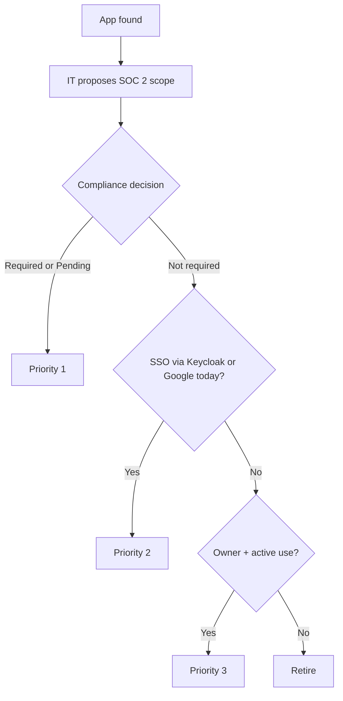

# App Inventory

> **MOCK DATA:** Illustrative sample for planning purposes.
> Shared by every workstream: [01 postmortem](01-incident-response/postmortem.md) (impact), [03 IdP migration](03-identity-sso-migration/PLAN.md) (what moves to Okta and in what order), 04 HR lifecycle (group rules), 05 gap assessment (access findings).

## Inventory Completeness

| App type | Confidence | Why |
| --- | --- | --- |
| **SSO via Keycloak** | **Complete** | Every Keycloak client was touched during the [IdP outage](01-incident-response/postmortem.md), including 2 nobody could identify |
| **Sign in with Google** | **Complete** | Google's OAuth grant records list every app users sign in to with Google |
| **Password apps** | **Likely incomplete** | No central record. At a startup, teams sign up for tools on their own |

### Finding the missing password apps (proposed)

| Source | What it finds |
| --- | --- |
| Expense / corporate card data | Paid SaaS subscriptions, including ones IT has never heard of |
| 1Password vault entries (especially shared vaults) | Apps people log in to with passwords; shared vault items point to shared accounts |
| Device app inventory (Iru, CrowdStrike) | Desktop apps that have a SaaS back end |
| Department head survey | Free-tier tools that don't show up in spend |
| Vendor contracts / procurement | Apps with contracts but low visible use |

Every newly found app goes through the same compliance scoping and prioritization below.

## Compliance Scoping & Okta Priority

**Process:** IT proposes SOC 2 scope for each app based on what it touches (customer data, production access, security tooling, HR records used as joiner/leaver evidence). **Compliance confirms.** Apps still **Pending** are treated as in scope until Compliance says otherwise.

| Priority | Criteria | Why |
| --- | --- | --- |
| **1** | SOC 2 required (or pending) | Must be on Okta with group-based access, MFA, and deprovisioning before the observation window |
| **2** | Existing SSO apps, not in SOC 2 scope | Must move to retire Keycloak. Usually quick: already SAML or Google |
| **3** | Other password apps | SSO where the vendor supports it; otherwise Okta password vaulting, or retire |
| **Retire** | No owner or no use | Not migrated |

**"Sign in with Google" apps:** these move behind Okta automatically once Google Workspace federates to Okta. For Priority 1 apps that's not enough: they still need direct SAML/SCIM so access is removed when someone leaves.

| App | Auth Today | Discovered Via | SOC 2 Scope (proposed) | Compliance | Okta Priority |
| --- | --- | --- | --- | --- | --- |
| Google Workspace | SAML via Keycloak | Keycloak client | Required: email, documents, customer data | Confirmed | 1 |
| AWS | SAML via Keycloak | Keycloak client | Required: production | Confirmed | 1 |
| GitHub | SAML via Keycloak | Keycloak client | Required: source code, change management | Confirmed | 1 |
| Jira / Confluence | Sign in with Google | Google OAuth grants | Required: change management evidence | Confirmed | 1 |
| Datadog | Sign in with Google | Google OAuth grants | Likely required: production logs may contain customer data | Pending | 1 |
| Slack | Sign in with Google | Google OAuth grants | Customer data shared in channels? | Pending | 1 |
| Salesforce | Password | Expense data | Required: customer data | Confirmed | 1 |
| Zendesk | Password | Expense data | Required: customer PII | Confirmed | 1 |
| 1Password | Password (master) | IT-managed | Required: credential store | Confirmed | 1 |
| Rippling | Password | IT-managed | Required: joiner/leaver evidence | Confirmed | 1 |
| CrowdStrike Falcon | Password | Security-managed | Required: security tooling | Confirmed | 1 |
| Iru | Password (new tenant) | IT-managed | Required: device controls | Confirmed | 1 |
| NetSuite | Password | Finance team | Financial system; usually not SOC 2 security scope | Pending | 1 |
| Mailchimp | Shared password | 1Password shared vault | Customer email lists? | Pending | 1 |
| Greenhouse | SAML via Keycloak | Keycloak client | Not required: candidate data | Confirmed | 2 |
| Zoom | Sign in with Google | Google OAuth grants | Not required | Confirmed | 2 |
| Figma | Sign in with Google | Google OAuth grants | Not required | Confirmed | 2 |
| Lucidchart | Sign in with Google | Google OAuth grants | Not required | Confirmed | 2: retire if no owner found |
| 2 unidentified Keycloak clients | SAML via Keycloak | Keycloak client | n/a | n/a | Retire (postmortem item 12) |
| JumpCloud | Password | IT-managed | n/a: being replaced by Iru | n/a | Retire after [MDM migration](02-mdm-reenrollment/PLAN.md) |

## Assignment Review

| Column | Meaning |
| --- | --- |
| Business Owner | Accountable for who should have access |
| Technical Owner | Administers the app; executes the SSO/provisioning change |
| Assignment Today | **Org-wide**, **Group**, **Individual**, or **Shared account** |
| Ideal? | Is the assignment *method* right for this app? |
| Correct? | Are the right *people* assigned? |
| Proposed Assignment | Target assignment model in Okta |
| Owner Review | Not started → Sent → In review → Signed off |

| App | Business Owner | Technical Owner | Assignment Today | Groups / Scope | Assigned | Ideal? | Correct? | Proposed Assignment | Owner Review |
| --- | --- | --- | --- | --- | --- | --- | --- | --- | --- |
| Google Workspace | IT | IT | Org-wide | All Employees OU | 400 | Yes | No: 9 suspended users still licensed | Org-wide via `All Employees` group | Signed off |
| AWS | VP Engineering | DevOps Lead | Group | `eng-aws-admins`, `eng-aws-readonly` | 62 | Yes | No: 3 non-engineers in `eng-aws-admins` | Groups mapped to permission sets | In review |
| GitHub | VP Engineering | DevOps Lead | Group | `engineering@` | 118 | Partial: one group grants all repos | Yes | Team-based groups | Not started |
| Jira / Confluence | Eng Ops | IT | Org-wide | n/a | 260 | Yes | Yes | Org-wide via `All Employees` | Signed off |
| Datadog | VP Engineering | SRE Lead | Org-wide | Any domain account | 140 | No: any employee can sign in | Yes | Group: Engineering | Not started |
| Slack | IT | IT | Org-wide | Any domain account | 412 | No: domain sign-up lets anyone with a company Google account join | No: 12 accounts not in HR export | Group: `All Employees` + `Contractors - Slack` | In review |
| Salesforce | VP RevOps | Salesforce Admin | Individual | n/a | 108 | No | No: 6 departed users still active | Groups: Sales, CS, RevOps | Sent |
| Zendesk | Dir. Support | Support Ops | Individual | n/a | 44 | No | No: 2 shared agent logins | Group: Support | Sent |
| 1Password | Security | IT | Org-wide | n/a | 400 | Yes | Yes | Org-wide via `All Employees` | Signed off |
| Rippling | People Ops | People Ops | Org-wide (self-service) | All employees | 400 | Yes | Yes | Org-wide via `All Employees`; admins via group | Not started |
| CrowdStrike Falcon | Security | Security | Individual | n/a | 5 | Partial: admins added by hand | No: 1 departed IT admin still active | Group: `Security Admins` | Not started |
| Iru | IT | IT | Individual | n/a | 4 | Yes | Yes | Group: `IT Admins`, SSO from day 1 | In review |
| NetSuite | Controller | Finance Systems | Individual | n/a | 12 | Partial: small and sensitive, but no approval trail | Yes | Group gated by access request approval | Not started |
| Mailchimp | Marketing Mgr | **Unknown** | Shared account | n/a | 1 login / 4 people | No | No | Individual accounts via group, or retire | Sent |
| Greenhouse | Dir. Talent | People Ops | Group | `recruiting@`, `hiring-managers@` | 85 | Yes | No: `hiring-managers@` maintained by hand, stale | Group: `Recruiting` + rule-based `Hiring Managers` | In review |
| Zoom | IT | IT | Org-wide | n/a | 395 | Yes | Yes | Org-wide via `All Employees` | Signed off |
| Figma | Design Lead | IT | Individual | n/a | 58 | No | No: 9 paid seats unused for 90+ days | Groups: Design (editor), Product (viewer) | Sent |
| Lucidchart | **Unknown** | **Unknown** | Individual | n/a | 22 | ? | ? | TBD: find an owner or retire | Owner not identified |

## Summary

| Metric | Count |
| --- | --- |
| Apps tracked | 21 (18 to migrate, 3 to retire: JumpCloud + 2 unidentified Keycloak clients) |
| Priority 1 / 2 / Retire | 14 / 4 / 3 |
| SOC 2 scope still pending with Compliance | 4 |
| Assignment not ideal (No / Partial) | 9 |
| Assignment not correct | 9 |
| Owner unknown | 1 business, 2 technical |
| Owner signed off | 4 |
